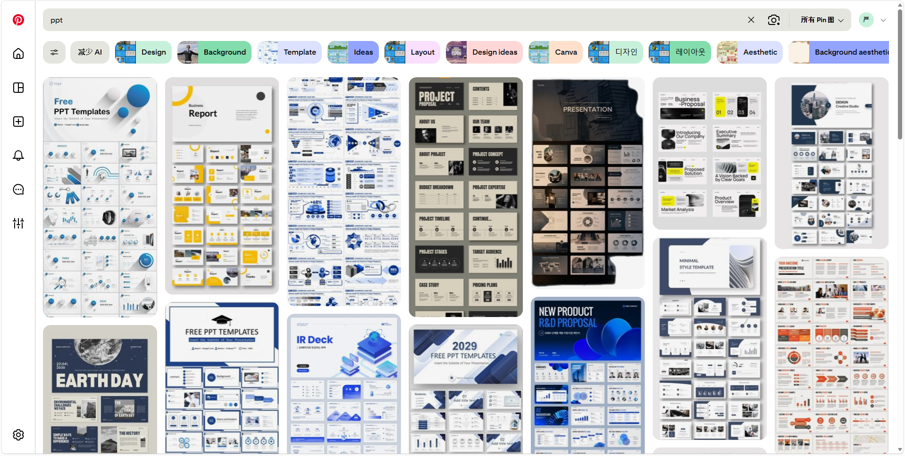
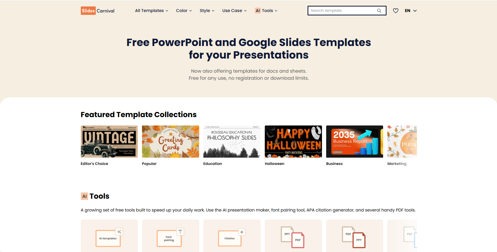
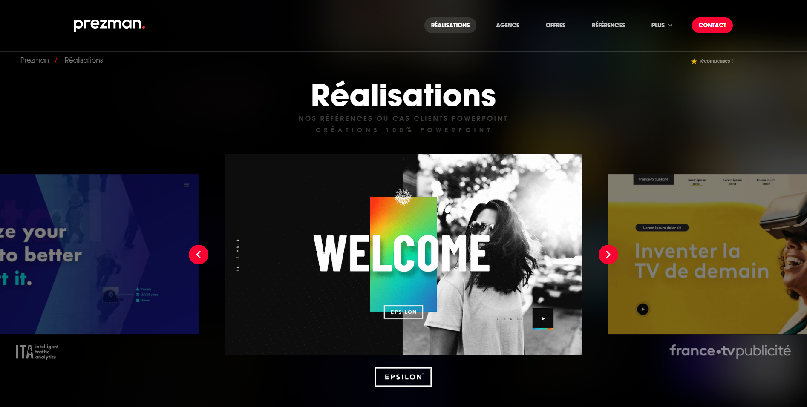

自从AI编程能力爆发后，在各种场景里，都冒出了不少新玩法。

不过，平时我接触得最多的，还是学习/办公场景的应用。其中一个我很想解决、也觉得不少人都想优化的工作流，就是PPT制作。

以前做PPT，流程大概是这样的：确定主题内容→找模板→分章节模块→填充内容和素材→排版美化→N轮微调……

看起来，大量时间都花在了最后的排版上。但最核心的环节，其实还是一开始的信息收集和整理。

对我而言，确定了要写什么、重点是什么，后面的结构、布局和排版，才有了顺藤摸瓜的依据。

所以说吧，做PPT本质上就是把杂乱的材料整理成有逻辑、有重点的信息，再通过图文表达，让别人更容易理解和记住。

《金字塔原理》中有个核心观点：分层组织支撑它的内容。在PPT制作场景中，就是先想清楚整份材料要说明什么，再确定每一部分、每一页分别承担什么作用。

每一页中都要尽可能去掉无关信息，用线索突出内容的组织关系，再把对应的文字和图片放在一起。

这也是为什么我会把信息采集放在第一步。

在我用AI做PPT一段时间后，我把个人经验总结成了一套SOP(Standard Operating Procedure)——我愿称之为——PPT 2.0时代

## 01 信息采集

就如我前面所说，第一步看似简单，但对于AI而言是最重要的。

当我们提供足够多的信息后，AI才能充分理解，丰富自己的设计大脑。

事先创建一个Word/Markdown文档，可以分两种类型来写，**简洁型**和**精致型**。

**简洁型**的文档中，可以放这些内容：给谁看、什么场合、希望对方看完记住什么、大概要讲多久、必须出现哪些内容、页数等。

这种信息提供方式，主要适用于普通的课堂汇报、趣味性的展示等，对内容、排版和风格没有那么严格的要求。比如之前的乱讲PPT大赛，就非常适合这种随意的风格。

**精致型**的文档，就是在简洁型文档的基础上扩充，写清楚每一页你要展现的内容，甚至是布局、结构。

一般来说，AI会根据自己的理解做分页，每一页要写什么文案、放什么图片，如果不做硬性限制，就可能在最后要反复修改。

如果你对PPT的要求比较高，那么你的文档中就要将各种细节尽可能描述清楚。

举个例子：

```markdown
第4页：介绍咖啡店秋季上新的三款饮品。使用我提供的三张饮品照片，每款标注名称、价格和一句口味介绍，具体信息以菜单为准，不要自行添加销量或“最受欢迎”等描述。标题、价格和介绍文字需要保留为可编辑文本。布局可由AI决定，以图片清晰、三款饮品方便对比为准。
```

当然，如果你想偷懒，也可以先准备好素材，分成两个或更多文件夹：

- 原始资料：报告、论文、数据表，方便核对内容。
- 正式素材：真正要放进PPT的产品截图、活动照片、Logo等。

素材根据制作场景因人而异，做课程/学术汇报PPT，就提供论文、图表、实验数据等；做产品介绍，就提供系统页面、操作手册等。

原始资料里的内容不一定都要放进PPT，风格参考里的文案和数据，也不代表可以直接使用，这些都是你要提前明确的，避免AI混用。

准备好一切后，让AI整理逐页稿：

```markdown
请阅读我上传的内容说明、原始资料和图片素材（或者访问该项目的本地文件目录）。本轮只整理内容，不生成PPT、不生图。 先用几句话复述你理解的：这份PPT给谁看、用于什么场合、核心观点是什么，以及希望观众看完记住什么。

请区分几类材料的用途：

- 原始资料：用于提取信息、核对事实。
- 正式素材：用于后续页面展示。

如果缺少会影响核心观点、内容取舍或事实准确性的信息，先集中列出需要我补充的问题。其他不影响主线的缺项，可以标注“待补充”，继续整理。

然后按照我提供的页数、顺序和逐页要求，整理成逐页稿。如果我没有指定分页，请结合演讲时长建议页数和顺序，并简要说明安排逻辑。
每页写清楚：

1. 标题：优先表达这一页的核心观点
2. 想表达的意思：这一页要让观众理解什么
3. 屏幕文字：实际放在页面上的精简文案
4. 数据与来源：注明对应文件、页码或链接；没有则不填
5. 图片素材：写出要使用的文件名及用途；缺少则标注待补充
6. 建议布局：简要说明文字、图片或图表如何组织
7. 演讲备注：放不必全部显示在屏幕上的补充说明

允许精简表达，但不能改变原意，不得补造数字或事实。必须保留我明确指定的内容；如建议调整，请单独说明。资料有冲突、内容有重复、某页太挤，请具体指出并给出建议。不要为了凑页数添加空泛章节，也不要把所有资料都塞进PPT。

最后汇总需要我确认或补充的事项。

等我确认逐页稿后，再进入设计。
```

## 02 审美参考

第一步内容确定后，就可以开始规定设计风格了。

一般来说，我是直接找参考图给AI复刻，比纯文字的描述具体多了。

这里推荐几个我常用的网站。

### 1. Pinterest



### 2. SlidesCarnival



### 3. Slideland


### 4. prezman



在提供了参考图后，可以让AI拆解图片中的结构和细节，简单来说就是对图片做一次蒸馏。

可以参考以下prompt：

```markdown
请结合已经确认的逐页稿，分析我提供的风格参考。本轮先确定设计方向，不生成PPT、不生图。
我喜欢：【具体特点，例如米白底色、大标题、图片排布】
我不喜欢：【具体特点，例如装饰过多、正文太小】
使用场景：【现场投屏/电脑阅读/打印】
其他限制：【品牌色、中文字体、页面比例等；没有可留空】
先简要拆解参考图中的：配色、字体特征、字号层级、对齐方式、留白、图片处理和装饰元素。请区分哪些是图片中能明确观察到的，哪些是你根据我的内容提出的设计建议。无法确认的字体，不要猜成确定的字体名称，可以推荐气质接近、支持中文的替代字体。

然后提出几个构图明显不同的设计方向，不要只是更换颜色。

每个方向说明：

1. 整体视觉特点，以及为什么适合这份内容
2. 背景色、正文色、强调色，给出建议色值
3. 中文字体、标题和正文字号、页面边距
4. 封面、普通图文页、数据页、流程页的布局建议；只覆盖逐页稿中实际需要的页面类型

保持整体风格一致，但不要让每页长得一模一样。参考图中的小字、低对比度或过密排版，如果不适合我的使用场景，请指出并调整。不要为了套用参考风格，擅自删改已经确认的核心内容。

等我选定方向后，再整理成“风格说明.md”。如果当前环境不能保存文件，就输出可直接复制的Markdown。后续制作沿用这份说明。
```

这一阶段，就是把配色、字体、排版等细节拆解清楚，形成一份后续可以反复使用的风格说明。

先把风格确定好，后面修改某一页时也有统一的依据，避免改着改着，像是几套PPT拼凑在一起。

你也可以直接跳过这一步，只提供参考图，个人觉得做风格拆解会更准确一点。

## 03 模式一：HTML Slides

下一步就开始制作PPT了。

第一种方式，估计是AI出来后最实用、方便的一种了。

那就是直接生成一个HTML Slides。

很多人不知道这种玩法，那就是通过代码直接在网页做成PPT的效果，这种方式下可以加入很多动画效果，比较适合炫技。

当然，你所加入的交互效果，目的都是为了辅助解释内容，也没必要做得过于花里胡哨。

这里推荐三个可选的Skill：

- **frontend-slides**：专注HTML演示文稿，提供风格预览、固定16:9画布和多种设计参考。如果是做普通分享、主题演讲，可以先试试这个。

- **huashu-design**：覆盖幻灯片、原型、动画和信息图，官方也展示了中文讲座与科普案例。如果内容需要结合更丰富的图片、图解和动态演示，可以一试。

- **visual-explainer**：侧重流程、架构、数据和技术概念的可视化，也支持幻灯片。内容里有较多关系和机制需要讲清楚时，可以作为补充选择。

前面的内容稿、风格说明和素材可以继续沿用，只需要换一下制作要求：

```markdown
请使用［选定的Skill］，根据已确认的逐页稿、风格说明和正式素材，制作一套HTML Slides。

用于［演示场合］，面向［目标受众］。直接完成整套，保持原有内容逻辑与页序，不新增未经资料支持的事实、数字或结论。

一、页面与视觉9


标题和正文使用真实HTML文字，图表、流程和示意图尽量使用可渲染的元素，不要把整页图片当作HTML幻灯片。沿用已确认的风格，统一配色、字体层级和页脚。根据内容调整构图，避免每页套同一种卡片布局。

二、演示与交互

支持左右键翻页、上一页和下一页按钮、全屏及页码。提供目录或概览，方便现场跳转到指定页面。动画只用于解释顺序、状态变化和突出重点。需要交互的页面，可以使用分步展开、方案切换等方式，但不能让关键内容只能通过悬停才能看到。操作后应能返回初始状态，方便重复演示。
三、离线与备用材料

优先交付可本地打开、断网使用的版本，将必要的图片、字体和脚本一并打包，不依赖外部CDN或临时图片链接。如果必须启动本地服务，或某项功能需要联网，请提前说明，并给出明确的打开方式。同时导出PDF备用稿，一张幻灯片对应一页。PDF中展示动画和交互页面的完整关键信息，不要出现空白、隐藏内容或演示控制按钮。
四、检查与交付

在浏览器中检查全部页面的文字、图片和交互，测试翻页、全屏、窗口缩放、页面跳转和断网重开。修正文字溢出、元素遮挡、图片丢失等问题。交付入口HTML、完整素材文件夹和PDF备用稿，整理到同一文件夹中，并告诉我从哪个文件打开、需要什么运行条件，以及还有哪些已知限制。
```

这里注意一个小细节，除了提供风格说明，你也可以把参考图一起给AI参考。

最后做出来的HTMLSlides可以直接在网页端播放展示，也可以转化为PDF用于分享。

## 04 模式二：视觉优先

如果你更看重视觉效果，或者想先看看预览图，可以采用视觉优先法。

流程是：将你的素材、逐字稿、风格说明直接交给ChatGPT/Codex，用GPT Image 2.5生成效果图。

这时，每一页就是一张完整的图片，文字、配图和背景都在里面。你可以直接看到最终画面，但后续修改也需要针对图片进行。所以，前面的内容定稿和风格参考，在这一步就很重要了。

生成效果图的prompt可以参考如下（根据实际需求调整）：

```markdown
请根据我上传的原始资料、正式素材、已确认的逐页稿和风格参考，生成一套16:9宽屏比例的幻灯片图片，用于［汇报场合］，面向［目标受众］。使用GPT Image 2.5生成图片。如果当前入口无法选择或确认该模型，请如实说明，不要仅凭提示词声称已切换模型。
一、内容依据

以已确认的逐页稿为内容依据，原始资料用于核对事实，正式素材用于页面展示，参考图片只用于借鉴视觉风格。准确保留核心观点、数据、单位、时间和来源。允许为适应屏幕阅读精简措辞，但不能改变原意，不能自行补充事实、案例、数字或结论。发现资料冲突或关键信息缺失时，先指出，不要猜测。
二、视觉风格

提炼参考图中的配色、字体气质、标题层级、留白、对齐方式和图片处理方式，并贯穿整套页面。根据每页内容选择合适的构图：封面突出主题，观点页突出结论，数据页突出比较，流程页突出步骤与关系。保持整体统一，同时让不同页面有各自的信息重点，不要每页套用同一个版式，也不要只换背景颜色。
三、信息表达

每页围绕一个明确主题组织信息，建立清楚的阅读顺序。避免大段文字堆砌，将补充说明留在逐页稿中，画面优先呈现观众需要看清、记住的内容。根据内容需要使用图片、图表、流程图或机制示意图，不要为了装饰强行增加图形：
1. 数据比较：选择适合的图表，保留数值、单位和统计口径
2. 步骤说明：展示先后顺序、关键节点和必要分支
3. 机制解释：明确组成部分及其关系，不编造因果
4. 重点总结：提炼已有结论，不新增空泛口号
四、正式素材

按逐页稿使用指定图片，保持原比例和关键内容完整。产品截图、人物、Logo及原始图表不得擅自改画或替换。如当前工具无法准确使用某项素材，请说明，不要生成一张看似相近的图片冒充原素材。 

五、画面质量

每张图片对应一页完整幻灯片，画幅为16:9，不生成电脑屏幕、投影幕布、透视样机或多页拼图。 文字直接呈现在图片中，使用清晰、足够大的中文，保证会议投屏时能够阅读。标题、正文、数据标签与页脚层级分明，四周保留安全边距，不出现文字截断、重叠或溢出。不添加无关文案、随机英文、装饰性数字或额外水印。不要用复杂纹理干扰正文，也不要以缩小字体的方式硬塞内容。
六、整套生成与交付

按照已确认的逐页稿，一次性完成全部页面，无需先生成样页或中途等待确认。整套沿用统一的配色、字体气质、标题层级和页脚规范，根据各页内容调整构图，避免风格漂移或版式重复。

每页单独输出一张16:9高清图片，按“01_封面、02_页面标题……”依次命名，不要拼成多页长图或缩略图合集。生成过程中逐页核对文字、数字、素材及页序，确保没有漏页、重复页或未经确认新增的内容。全部完成后，按顺序交付所有图片；如当前环境支持文件打包，同时提供ZIP压缩包。
```

整套图片生成后，先核对文字、数字和素材，再检查排版，以及前后页面的风格是否一致。尤其留意中文错字、数据单位、图片细节，还有同一级标题是否忽大忽小。

如果要做局部修改，改完也要重新检查整页，毕竟是对图像本身做修改，生成效果不稳定。

确认无误后，把图片按页序合成 PDF，就得到了一份可以直接展示的演示材料。

如果你本身就有PPT模板，最好一起丢给AI，让它遵循模板设计。

如果你就是想复刻参考图，那就直接让AI高度遵从参考图的风格来设计，会比你提供风格说明要好一点。

而如果你的需求只是现场讲解、发送阅读，到这里就可以结束；但如果后续还需要频繁修改或者编辑，再考虑用ppt-master还原为PPTX。

但这里要提醒一下，之前生成的图片中，文字已经和画面融在一起，还原需要重新识别、拆分和排版，未必能同时做到完全一致和全部可编辑。

所以我建议可以优先保留复杂配图，把主要文字拆分出来，如果有一些需要更新数据的图表，就用原始数据重制。

还原时，可以参考以下prompt：

```markdown
请使用ppt-master-skill，将我上传的整份PDF转换为16:9宽屏比例的可编辑PPTX。

先按当前Skill说明选择适合的PDF转换或图片重建流程。
一、整套转换

处理PDF中的全部页面，保持原页序、页数和内容对应关系，不要漏页、重复页或擅自合并、拆分页面。

先检查PDF是文字型、图片型还是混合型，据此选择提取与重建方式。如原页面不是16:9，不要拉伸或裁切内容，请说明适配方案。
二、还原目标

尽量保留原PDF的整体设计、构图、配色和图文位置，同时让主要文字可以在PPT中编辑。

采用混合还原方式：

- 标题、副标题、正文、标签、关键数字和页码，使用可编辑文本框。
- 简单色块、线条和基础图形，尽量使用PPT原生形状。
- 复杂照片、插画和纹理，保留为独立高清图片。
- 需要更新数据的图表，使用我提供的原始数据重建；没有原始数据时，不猜测数值，明确说明编辑限制。
优先使用上传的正式素材，避免从PDF中反复裁切、压缩图片；保持图片原比例和关键内容完整。
三、文字与背景处理

对照已确认的逐页稿核对文字和数字；如未提供逐页稿，以PDF为准，识别不清的内容列出待核对。文字转为文本框后，必须清除背景中对应的原文字，避免出现重影，或修改后露出旧文字。不要将整页截图铺底，再覆盖文本框充当可编辑页面。文字与复杂背景粘连时，优先使用原始素材或无字背景。确实无法干净拆分的区域，保留必要的图片形式，并在交付说明中标明，不要强行补画造成失真。不得擅自改写内容，或改变产品外观、人物、Logo、图表含义及数据关系。

四、整套一致性与检查

统一同级标题、正文和页脚的字体、字号及位置规范，同时保留原PDF中不同页面的布局特点。不因统一格式而改变重点、遮挡内容或缩小文字硬塞。
逐页检查：

1. 文字有无错漏、重叠和溢出
2. 图片有无变形、模糊或裁切
3. 背景有无残留旧文字
4. 页序、数据、单位和来源是否准确
五、交付

直接完成整份PDF的转换，无需逐页等待确认。如需分批处理，请自行管理页序，最后合并为一个PPTX。交付完整PPTX及对应的整套PDF预览，并按页码列出：仍保留为图片的主要内容、无法准确识别的文字、明显还原差异和需要人工核对的事项。无法满足的要求如实说明，不将图片元素标为可编辑。
```

转化完成后，再打开PPT看看是否有组件错乱、文字乱码等问题。

遇到文字和复杂纹理粘连的页面，优先使用原始素材。确实拆不开的话，就让AI说明差异，再决定是保留图片or简化这一块的设计。

这两种模式也可以混用：封面和重点视觉页用生图，普通内容页、数据页直接制作可编辑 PPT。按照每页的用途选择，最后统一风格就行，只是实操会比较麻烦。

## 05 模式三：可编辑PPT

最后一种，也是实现难度最大的。

如果你想得到可编辑的PPTX文件，我推荐用[ppt-master](https://github.com/hugohe3/ppt-master)这个Skill，它可以直出可编辑的PPTX。

目前在生成可编辑PPT这块，ppt-master还算是独一档的。

你可以将之前准备的素材、逐字稿、风格说明一起丢给AI（可以让AI都放在同个文件夹下，这样就可以在同个项目空间内直接访问）。

生成PPT的prompt：

```markdown
请使用ppt-master-skill，根据已经确认的素材、逐字稿、风格说明，制作可编辑PPTX。

先做三页样稿：封面、内容最多的一页、图表或流程最复杂的一页。如果页面类型有重合，请另选一页，覆盖不同的排版需求。

先保留原页码，方便与内容定稿核对。

可编辑要求：

1. 标题、正文、页码和关键数字使用可编辑文本框
2. 需要更新数据的图表，使用带可编辑数据的原生图表，不要用矩形、线条拼出外观后，视为已经满足要求
3. 表格使用可编辑表格，保留增删行列和修改内容的能力
4. 流程图的节点、文字和连接线分别可编辑；移动节点时，连接线应能跟随调整
5. 复杂插画和照片可以使用图片，但标题、正文和需要修改的标注应独立保留
6. 如提供了强制使用的PPT模板，请沿用原模板的母版、版式及公共元素

严格使用已经确认的内容，不新增观点、事实或数字。不要用整页图片代替可编辑页面。如果某项要求无法实现，请明确说明限制和替代方案，不要自行降低要求。导出三页样稿的PPTX和对应预览图，说明哪些元素可编辑、哪些仍是图片，以及有无字体替换或其他需要注意的问题。

等我确认后，再继续制作全套。
```

这里我设定了让AI先做3页，如果我觉得还不错，再分批生成。

反之，如果做出来的PPT不太符合预期，那就需要重新调整了。

缺配图时，可以单独用GPT Image 2.5生成插画/图片，单独保存在图片库中，这样后面如果想改局部的内容，就不用连图一起重做。

## 06 最后优化

AI生成的第一版PPT，大概率不能100%满足你的需求。

所以，最后的环节就是根据你的实际需求再打磨，这时候你下达的指令也要尽可能详细，最好附上截图指明具体的位置，只需要把自己的感受和希望看到的结果说清楚就行。

可以参考下面的提示词：

```markdown
只修改第［ ］页，以我提供的实际打开截图为依据。

问题：［实际看到的问题］。希望改成：［具体结果］。允许修改：［布局、字号、图片大小等范围］。需要保留：［满意的设计、原文、数值、其他页面等］。

请先判断原因，再调整相关对象。不要为了修复局部问题，重做整页或整套风格。修改后重新导出并检查，确认原问题是否解决，同时检查有无新增的遮挡、溢出、变形或内容遗漏。把修正保存到制作源文件，避免下次导出又恢复旧问题。交付修改后的文件，并简要说明改了什么。同一个问题连续两轮没有改善时，先检查原因，不要继续重复生成。
```

如果你做的是PPTX可编辑文件，有些小细节可能自己改会更快；如果是做HTML Slides或者图片，那就要做好边界控制，不要让AI乱改。

一般来说，可以检查这些地方：

- 内容：有没有错字、漏页、重复页，数字、单位和来源是否准确
- 画面：文字有没有被遮住，图片有没有变形，重点能不能一眼看到
- 操作：翻页、动画和交互是否正常，断网后素材能否完整显示
- 备用稿（若有）：PDF是否与最终版本一致，动态页面有没有保留完整信息

## 07 总结一下

以上就是目前我摸索出来的一套比较完整的AI for PPT设计范式。

实践后会发现，AI还是很依赖我们提供的材料和参考。尤其涉及可编辑PPT时，也许整体画面看着不错，但文字、图表和组件的可编辑性还得看模型发力。

所以，我也建议尽量使用好的模型，比起你绞尽脑汁想文字内容来说，是降维打击的。

原始文档、PPT 模板、现成组件、正式素材和参考图准备得越清楚，AI实现时就越有依据。

我觉得，可以重点关注三个细节：

### 1. 先确定表达的内容，再思考如何实现。

PPT之所以叫PowerPoint，就是希望展示的内容是有力量的、关键的、言简意赅的。

所以就需要在最小的空间内最大化你所展现的信息，这就涉及到更复杂的PPT设计哲学和技巧了。

### 2. 关注视觉效果和可编辑度。

你所选择的最终产物形态不同，需要修改的地方也不同，但重点是视觉风格和可以自由编辑的灵活性。

### 3. 好的地方保留，抓住局部修改。

有些地方是AI做得好的，在修改的时候就要做好区分，只针对某个区域的某个组件进行调整，而不是整体大改。

相信我，如果细节没控制到位，你是要返工很多次的。

对我而言，这套SOP最大的价值，是能让我把更多精力放在内容本身，而不需要每次都自己拖拉拽各种组件，调整各种样式。

如果是比较正式的什么答辩汇报，我建议还是老老实实手搓吧【doge】

AI的出现，为我们迸发power提供了另一条路。无数的power落下，汇聚成一个个point......
