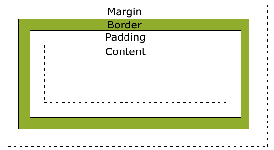
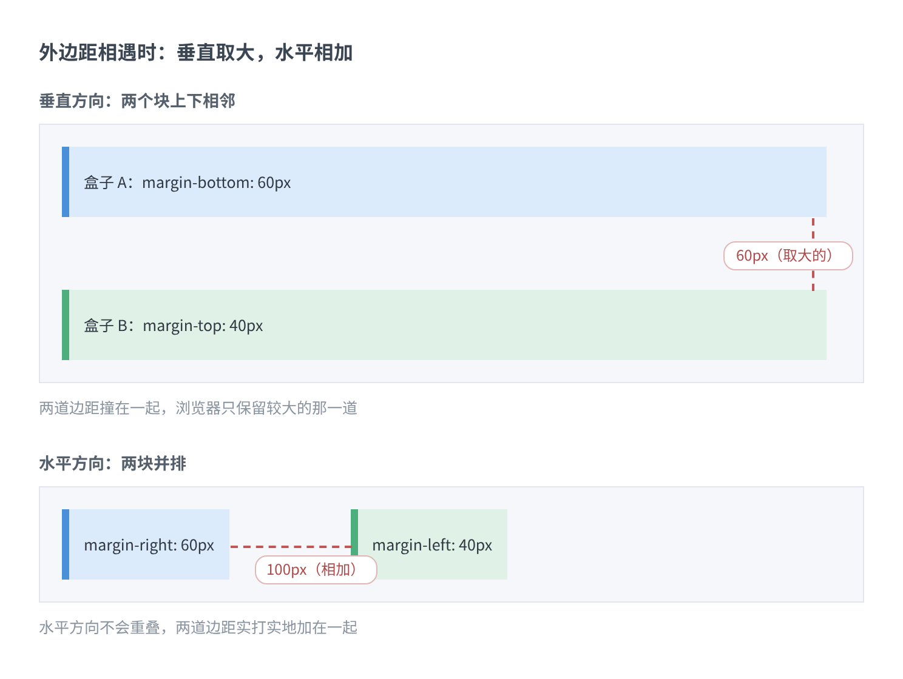
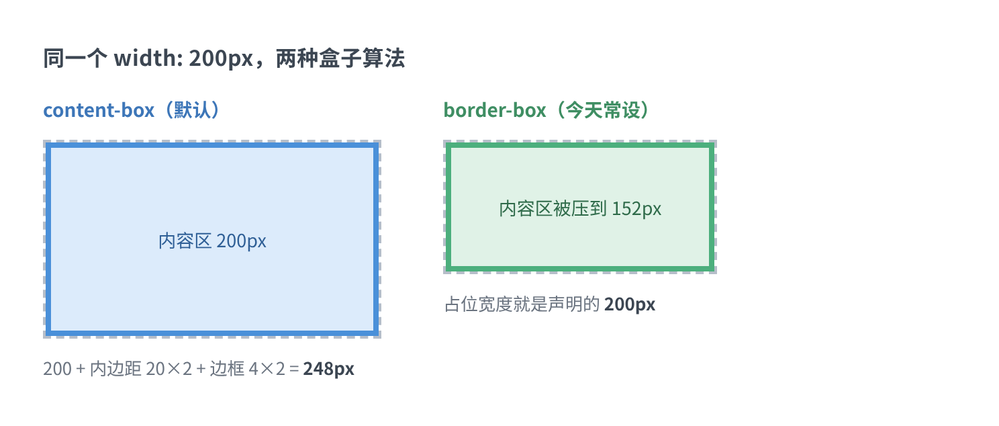
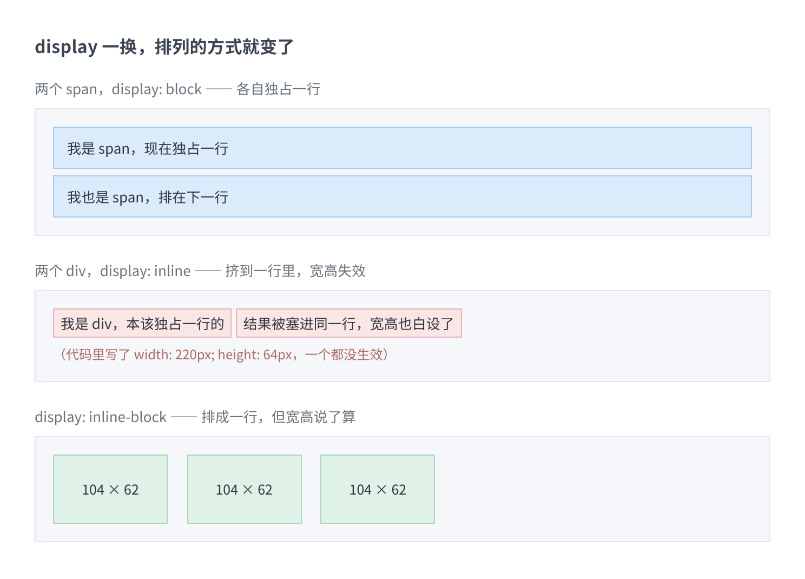
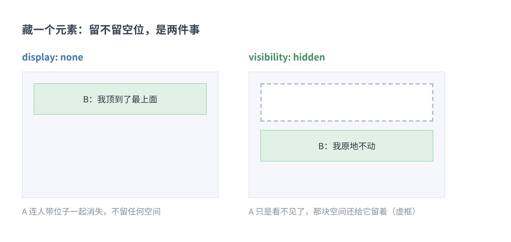
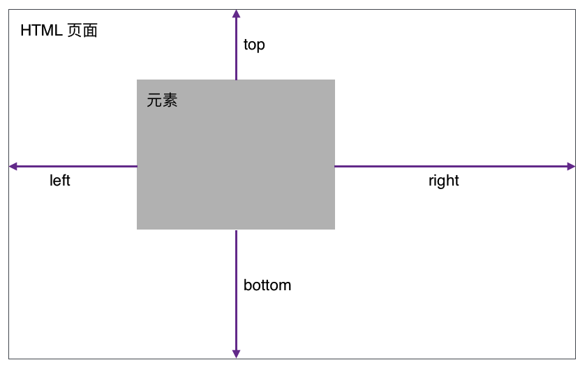
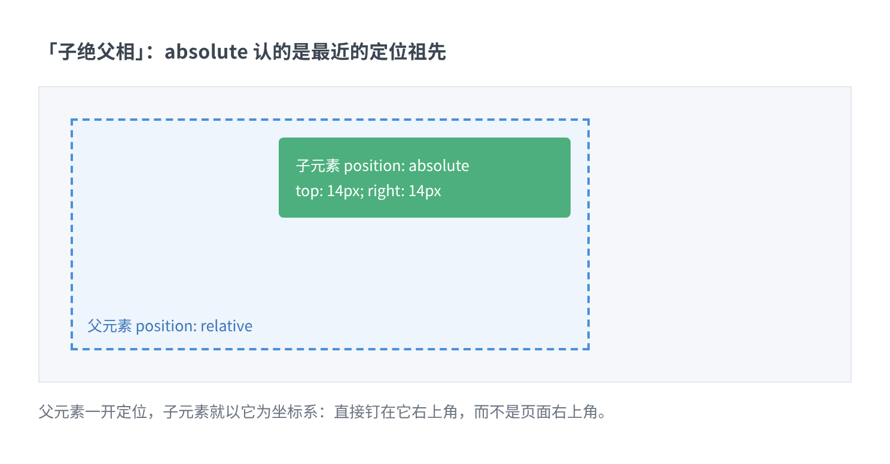
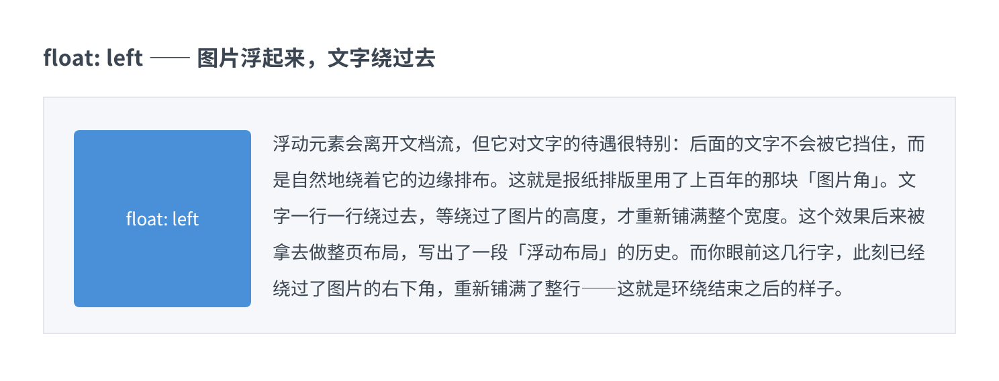
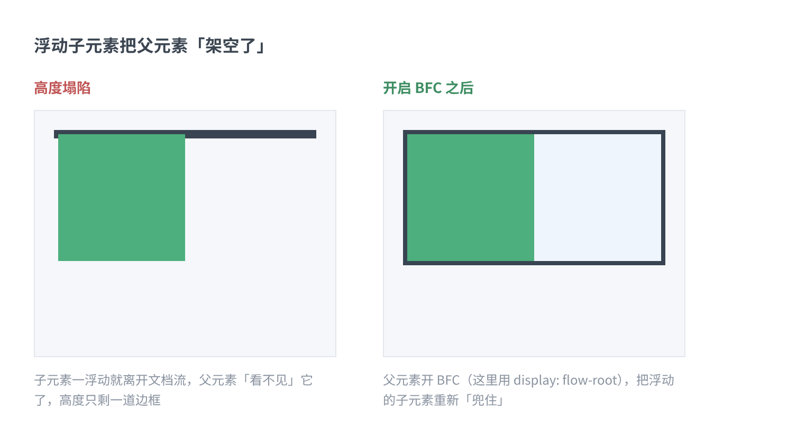
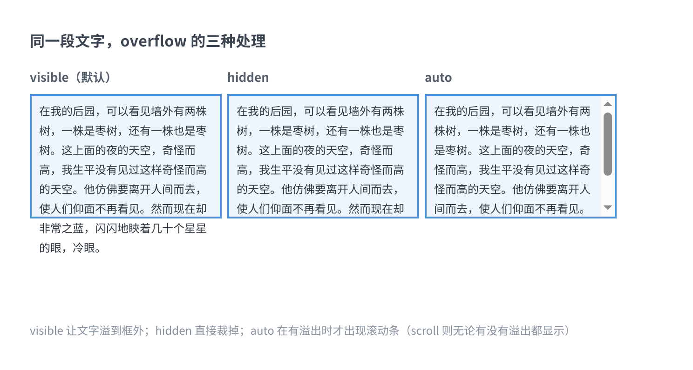

> 「HTML 让网页站起来，CSS 让它站有站相。」

上一篇把 HTML 的十八篇笔记写完了。页面是能打开了，但说实话不太好看：标题和正文一样大，链接顶着浏览器祖传的蓝紫色，内容从屏幕最左边贴到最右边，一点边角都不留。

这就是该 CSS 出场的时候了。

我学 CSS 记了十一篇笔记：简介、使用方法、语法格式、选择器、伪类、盒子模型、块级元素、可见性、定位、浮动、溢出。和上一篇一样，这篇把它们串成十一站，每一站配最短的示例和当年卡过我的地方。这次多了一件事：每一站末尾加一个「今天怎么写」的小注，说说这个知识点在今天的 CSS 里是什么处境。看自己的旧笔记时，我心里常犯嘀咕：这些写法现在还作数吗？提前说结论——作数，而且地基那几样一点没变，只是它们大多退到了二线，把前排让给了新来的。

学习路径还是老三样：学校课程把顺序和重点排好，跟着走；[MDN](https://developer.mozilla.org/zh-CN/docs/Web/CSS) 当字典，忘了哪个属性就翻；剩下全靠边做边查。CSS 的坑比 HTML 密，因为它有个坏脾气：写错了不报错，只是安静地不生效。你对着屏幕找了半天「为什么没用」，其实只是少了个分号。

十一站，从「CSS 到底是个什么东西」开始。

## 第一站：CSS 到底管什么

CSS 的全称是 Cascading Style Sheets，中文译作「层叠样式表」。名字值得拆开看。

**样式表**，是一组说明「每种元素该长什么样」的规则集合。字号、颜色、字体、边框、位置——网页的每一处外观，都由这组规则说了算。

**层叠**（cascading）是 CSS 的灵魂，也是它名字里最特别的词。它说的是：同一个元素可以被好多份样式同时管着——浏览器自带的默认样式、你写的样式、用户自己的偏好——它们像纸片一样一层层叠上去，冲突的时候按一套明确的规则裁决，而不是谁写得横谁算数。这套「裁决规则」就是后面要讲的优先级。

它管的事，一句话：**HTML 负责「有什么」，CSS 负责「长什么样」。** 翻 HTML 笔记时你会注意到一个反复出现的句式——「这个交给 CSS 管」：`font` 标签、`align` 属性、表格的 `border="1"`，这些当年被 HTML 大包大揽的外观活，后来统统移交给了 CSS。这份移交有个正式说法：**表现与内容分离**。内容写成一份与长相无关的档案，外观另存一份；想换皮肤，换掉样式表就行，内容一个字不动。

顺手记一段来历。1990 年代初，样式表其实已经以各种形式存在了，但那是各家浏览器自己的方言，网页在谁家浏览器里打开就是谁家的样子。1994 年，哈坤·利（Håkon Wium Lie）提出了 CSS 的最初建议；当时正在设计一款叫「Argo」的浏览器的伯特·波斯（Bert Bos）和他一拍即合，两人合作把 CSS 做了出来。此前也有过别的样式表建议，CSS 是第一个把「层叠」当主意的：作者的样式和读者的偏好可以继承、叠加、混合，各留各的余地。1994 年芝加哥的会议上 CSS 第一次亮相，1995 年两人又展示了一次；W3C 当时刚成立，对此很感兴趣，专门组织了讨论会。1996 年底 CSS 完成，同年 12 月 17 日 CSS1 作为 W3C 推荐标准发布（1999 年 1 月 11 日又修订了一版）；CSS2 紧随其后，1999 年 1 月 11 日发布，加了打印机、听觉设备这些「媒介」和可下载字体的支持。

至于 CSS3，它和前面两代有个本质区别：**不再憋一个大版本，而是把 CSS 拆成一堆小模块**，各自独立推进。这个决定影响深远，正好借着它说说今天。

> 今天怎么写：别再等「CSS4」了，它不会来。CSS3 之后的策略就是模块化，你听到的 flex、grid、变量、容器查询，全是一块一块的模块，各有各的升级节奏和浏览器支持时间表。所以查 MDN 的时候，别问「这是 CSS 几」，就看具体特性的兼容性表——那张表才是真正的「版本号」。

## 第二站：样式放在哪里：三种写法

写 CSS 的第一步不是语法，是搞清楚「样式写在哪」。笔记里记了三种。

**第一种，行内样式**：直接写在元素的 `style` 属性里，语法是 `style="css属性:css属性值;"`。

```html
<div style="color:red;">atguigu</div>
```

**第二种，内部样式表**：在页面的 `head` 里开一个 `style` 标签，把规则都写在里面。规则的模样就是后面要反复见的 `选择器 { 属性名: 属性值; }`：

```html
<head>
  <style type="text/css">
    div {
      color: red;
    }
  </style>
</head>
```

**第三种，外部样式表**：把 CSS 单独存成一个 `.css` 文件，用 `link` 标签引进来：

```html
<link href="div.css" rel="stylesheet" type="text/css" />
```

三个属性各管一摊：`href` 是 CSS 文件的路径，`rel="stylesheet"` 声明「我引的是样式表」，`type` 指定样式类型。`div.css` 里的内容就是纯规则，不带任何 HTML：

```css
div {
  color: red;
}
```

顺带澄清一个叫法。笔记把前两种都叫「内联样式」，但更常见的说法是：写在属性里的叫**行内样式**（inline style），写在 `style` 标签里的叫**内部样式表**，`link` 引进来的叫**外部样式表**。名字不影响使用，但去 MDN 或搜索引擎查资料时，叫对了才能查得着——这是我后来补的一课。

三种都能让页面变样，实际干活几乎全用外链：一份 CSS 所有页面共用，改一处全站生效，浏览器还能缓存。行内样式留给特殊场合，比如 JS 动态修改、或者邮件模板这种对 HTML 结构很敏感的页面。

> 今天怎么写：`type="text/css"` 在 HTML5 里可以省略，默认就是它，今天的教程多数已经不写了。另外，中大型项目里的 CSS 往往交给构建工具打包、压缩、注入，你甚至看不到 `link` 标签——但手写页面时，这一行 `link` 永远是最稳的写法，一点没变。

## 第三站：语法：一条规则而已

CSS 的语法用一行就能说完：

```css
选择器 { 属性名: 属性值; 属性名: 属性值; }
```

四个特点，笔记总结得很干脆：

- 每条声明都是键值对（key: value）的形式；
- 每条声明以分号结尾；
- 一组声明用大括号括起来；
- 为了好读，通常每行只写一条属性。

就这么点东西。注释是 `/* 注释内容 */`，可以写在一行里，也可以横跨多行；浏览器看都不看，纯粹是写给未来的自己。

真正要留心的是**值**的写法。拿颜色举例，红色至少有五种写法，效果完全一样：

```css
#show1 { color: red; }                 /* 颜色名 */
#show2 { color: #ff0000; }             /* 十六进制 */
#show3 { color: #f00; }                /* 十六进制简写：两两相同可缩成一位 */
#show4 { color: rgb(255, 0, 0); }      /* RGB 数值 */
#show5 { color: rgb(100%, 0%, 0%); }   /* RGB 百分比 */
```

一个细节：用百分比写 RGB 时，哪怕值是 0 也得带上 `%`，写成 `rgb(100%, 0%, 0%)`；其他情况下 0 就是 0。还有，值如果是多个单词的字体名，记得加引号：

```css
div { font-family: Courier, "Courier New", monospace; }
```

`Courier` 一个词，不用引号；`Courier New` 两个词，就得包起来，不然浏览器会当成两个字体名。

> 今天怎么写：现在常把常用的值存成变量，放在 `:root` 里，用的时候 `var()` 取——改主题色只改一处，全站跟着变：

```css
:root { --main-color: #4a90d9; }
a { color: var(--main-color); }
```

这东西叫 CSS 自定义属性（CSS variables），各家浏览器早就支持了，今天可以放心用。

顺便留一句体会：CSS 是**声明式**的——你只说「要什么」，至于怎么算出来、怎么画上去，是浏览器的事。这和后面学 JavaScript 时「一步步告诉电脑怎么做」的思路是两股道，脑子里先存着这个区别，学 JS 的时候会轻松些。

## 第四站：选择器：先把名字点对

CSS 的基本矛盾是：规则写好了，它到底管谁？选择器就是点名的方式。笔记里记了这几件工具。

最基础的四件：

```css
div { color: red; }        /* 元素选择器：点所有 div */
.myDiv { color: red; }     /* 类选择器：点 class="myDiv" 的元素 */
#show1 { color: red; }     /* ID 选择器：点 id="show1" 的那一个 */
[name] { color: red; }     /* 属性选择器：点带有 name 属性的元素 */
```

元素选择器按标签名点，一网打尽。类选择器按 `class` 属性点，最常用——同一个类可以贴在一堆元素上，改一处样式，它们一起变。ID 选择器按 `id` 点，但 `id` 是页面里唯一的编号，所以它一次只能点中一个元素。属性选择器更灵活，还能加运算符：

| 写法 | 意思 |
| --- | --- |
| `[attribute]` | 带有这个属性就行 |
| `[attribute=value]` | 属性值等于 value |
| `[attribute~=value]` | 属性值里包含这个词 |
| `[attribute^=value]` | 属性值以 value 开头 |
| `[attribute$=value]` | 属性值以 value 结尾 |
| `[attribute*=value]` | 属性值里含有 value 这段字符 |

基础工具之外，还有三把「按关系找人」的组合工具，值得放在一起记：

```css
div em { color: red; }    /* 后代选择器：div 里面（不管隔几层）的所有 em */
div > em { color: red; }  /* 子元素选择器：只有 div 的亲儿子 em */
div + div { color: red; } /* 相邻选择器：紧挨着 div 的下一个兄弟 div */
```

空格和 `>` 的区别就是「所有后代」和「只有亲儿子」；`+` 管的是「下一个兄弟」。这三个符号认全了，页面结构在你眼里就开始有层次了。

最后两样：**分组**用逗号，把同一组声明分给好几个选择器，省得抄六遍——

```css
/* 不分组：写六行 */
h1 { color: blue; }
h2 { color: blue; }
/* ……省略 */

/* 分组：一行搞定 */
h1, h2, h3, h4, h5, h6 { color: blue; }
```

**通配符** `*` 匹配任何元素：

```css
* { color: red; }
```

> Tips：笔记在这里留了一句「通配符选择器的性能并不好」。这话搁在 CSS2 时代是正理，今天的浏览器引擎早就把选择器匹配优化得很好了，`*` 本身不再是性能问题。真正要小心的是它**没分寸**——`* { margin: 0; }` 一刀切下去，连你没见过面的内置元素都改了，页面哪里怪了都找不到主。所以不是不能用，是用了要知道自己在切多宽。

> 今天怎么写：现代项目的趋势是「选择器写扁」——尽量用单个类名点穴，少用 ID、少深嵌套。原因下一站就能看到：每多一层嵌套，优先级就往上加一点，加着加着就没人算得清了。另外，`:is()` 和 `:where()` 这对新工具如今已经铺开，`where()` 还能把一组选择器的优先级直接归零，专门用来写「随时欢迎被覆盖」的默认样式。

## 第五站：伪类：悬停、点击，这些「状态」也归样式管

选择器点的是「元素」，伪类点的却是元素的**状态**：鼠标悬停上去了、被点了一下、拿到了键盘焦点。笔记列了六个：

| 伪类 | 作用 |
| --- | --- |
| `:active` | 被激活（点击按住的瞬间） |
| `:focus` | 获得键盘焦点 |
| `:hover` | 鼠标悬停在上面 |
| `:link` | 未被访问过的链接 |
| `:visited` | 已访问过的链接 |
| `:first-child` | 作为第一个子元素 |

最典型的是链接的四种状态，写在 `a` 元素上：

```css
a:link { color: #FF0000; }    /* 没访问过 */
a:visited { color: #00FF00; } /* 访问过了 */
a:hover { color: #FF00FF; }   /* 鼠标悬停 */
a:active { color: #0000FF; }  /* 正被点着 */
```

这四个写起来简单，但顺序是有讲究的：`link` 和 `visited` 要在前，`hover` 必须在它俩之后，`active` 排最后。为什么？因为四个选择器的「分量」一样重（都是一个元素加一个伪类），分量打平时，**写在后面的赢**。回忆一下点链接的过程：鼠标一悬停，`:link` 和 `:hover` 同时成立——要让悬停的颜色生效，`:hover` 就必须写在 `:link` 后面；按住鼠标的瞬间，`:hover` 和 `:active` 同时成立——`:active` 就得排最后。我当年把它记成「爱恨原则」：**LoVe HAte**，`link`、`visited`、`hover`、`active`，顺序天然就对。至于这一切背后的「分量」是怎么回事，正是下一站的正题。

`:first-child` 的用法是另一个思路——它不挑元素，挑位置：

```css
p:first-child { font-weight: bold; }
```

作为某个父元素第一个子元素的 `p`，加粗。列表第一项、表格第一行要特殊处理时，它很好使。

> 今天怎么写：伪类后来长成了一个大家族：`:nth-child(2n)` 做表格斑马纹、`:not()` 排除、`:focus-visible` 只在键盘聚焦时亮焦点框……另外记一笔实践经验——`:hover` 在触屏上不可靠（手指没有「悬停」这个概念），关键信息别只放在悬停里。

## 第六站：优先级：同一块元素，听谁的

到了 CSS 最像「制度」的部分。同一块元素经常被好几条规则同时命中，谁说话算数？笔记给的算法是**给每种选择器记分**：

- 行内样式（写在 style 属性里）：1000
- ID 选择器：100
- 类选择器：10
- 元素选择器：1
- 通配符选择器：0
- 继承来的样式：没有分量，直接不计

规则也简单：一条规则里有多个选择器，分数**相加**；分数高的赢；两个一样高，**后定义的赢**；加了 `!important` 的，直接升到最高。还有一条容易忽略的：分数各站各的位，不会「进位」——元素分攒得再多，也压不过一个类选择器。

拿个例子算一遍。假设下面四条规则同时命中同一个段落：

```css
p { color: gray; }            /* 1 */
.note { color: blue; }        /* 10 */
div.note p { color: green; }  /* 1 + 10 + 1 = 12 */
#main .note { color: red; }   /* 100 + 10 = 110 ← 赢 */
```

前面三条越写越具体，分数稳步上涨；最后一条里的 `#main` 一亮相，100 分直接压场。这就是为什么「ID 选择器少用」——它太沉了，压上去之后正常的覆盖手段很难翻盘，只能请出 `!important` 或者更长的选择器链，一层套一层，最后谁也算不清。

> Tips：`!important` 是个警报器，不是个工具。它存在是为了兜住极少数「外来样式必须让路」的场景；如果一篇样式表里它频繁出现，说明优先级已经在打架了，正确的做法是回去重新组织选择器，而不是把音量拧得更大。

> 今天怎么写：现代 CSS 工程的共识是「主动压低优先级」：样式尽量都用单个类名写，谁都不欠谁，覆盖关系一目了然。BEM 那类命名约定看着啰嗦，本质就是在避免优先级战争。当年得靠人自觉，现在还多了工具——`:where()` 能把一组选择器的分量直接清零，专门用来写「随时欢迎被覆盖」的默认样式。

## 第七站：盒子模型：CSS 里最重要的一笔账

学 CSS 前我以为最难的会是各种各样的属性，后来发现，一切复杂都从一句话开始：**页面里的每个元素，都是一个盒子**。

盒子由四层组成，从里到外：



- **Content（内容）**：盒子里真正的内容，文字、图片；
- **Padding（内边距）**：内容和边框之间的那圈留白；
- **Border（边框）**：盒子自己的边框；
- **Margin（外边距）**：盒子与其他盒子之间的间隔。它完全透明，也没有背景色。

记住这个顺序有个笨办法：**从里往外，内容、内边、边框、外边**。内边距是「自己家里的装修」，外边距是「和邻居之间的空地」。

### 宽度到底怎么算

笔记里的经典例子，一个盒子设置了这些：

```css
width: 250px;
padding: 10px;
border: 5px solid gray;
margin: 10px;
```

它占多宽？250 的内容 + 左右各 10 的 padding + 左右各 5 的 border = 元素本身 280px；再算上左右各 10 的 margin，在页面上「占道」一共 300px。另一个例子：`width: 220px; padding: 10px; border: 5px solid gray;`，总宽就是 220 + 20 + 10 = 250px。

算账不难，难的是记住这个事实：

> **设置的 `width` 和 `height`，只管内容区。** 想让盒子显示多大就多大，浏览器可不替你把这些边距和边框算进去——它默认就是这么耿直。

### 边框、内边距、外边距

这三兄弟的写法套路一模一样，学会一个就会三个。以边框为例，它有三条线：`border-width`（宽）、`border-color`（颜色）、`border-style`（样式）。每条线都支持写 1 到 4 个值，顺序规则是**从上面开始顺时针**：

```css
border-width: 10px;                    /* 四边都是 10 */
border-width: 10px 20px;               /* 上下 10，左右 20 */
border-width: 10px 20px 30px;          /* 上 10，左右 20，下 30 */
border-width: 10px 20px 30px 40px;     /* 上 10，右 20，下 30，左 40 */
```

边框样式的备选值记一下，`solid`（实线）和 `dashed`（虚线）最常用：

| 样式 | 效果 |
| --- | --- |
| `none` / `hidden` | 无边框 |
| `dotted` | 点状 |
| `dashed` | 虚线 |
| `solid` | 实线 |
| `double` | 双线 |
| `inherit` | 继承父元素 |

嫌分开写麻烦，有简写：`border: 5px solid red;`，宽度、样式、颜色一把抓，顺序没有硬性要求。想单独收拾某一条边，就 `border-top`、`border-right`、`border-bottom`、`border-left` 各管各的。

内边距 `padding` 和外边距 `margin` 沿用同一套 1 到 4 个值的规则，一个字不用改：

```css
padding: 25px 50px;              /* 上下 25，左右 50 */
margin: 25px 50px 75px 100px;    /* 上 25，右 50，下 75，左 100 */
```

两者有一个重要区别：padding 在盒子内部撑大它，看得见（背景色会跟着扩）；margin 在盒子外面，透明，不影响盒子本身的大小，只影响它和别人的距离。还有个默认事实：元素在页面里靠左靠上排，所以调 `margin-top` 和 `margin-left` 是挪自己；调 `margin-bottom` 和 `margin-right`，挪的是后面元素相对自己的位置。

### 外边距重叠：新手的第一个「灵异事件」

这段值得单开一小节，因为它太反直觉了。给上下相邻的两个盒子设置外边距：上面的 `margin-bottom: 100px`，下面的 `margin-top: 100px`，两盒之间隔多远？直觉是 200，实际是 **100**——垂直方向相邻的外边距会**重叠**，取两者中较大的那个。



同一个现象还有第二种形态：父子之间。给子元素设 `margin-top`，如果父元素没有 padding 或边框挡着，这个外边距会**穿墙**——整个父元素带着里面的内容一起往下移，像是父元素自己长了 margin。笔记给的解法是给父元素加 `padding-top`（把墙修厚），本质上是给父子之间放点东西隔开。后面讲 BFC 时，会看到一把更利索的「开关」。

### 内联元素的盒子是「残次品」

内联元素（`span`、`a` 这些）的盒子玩法不一样，笔记单独列了一节，几句话总结：

- 宽高不支持——大小由内容决定；
- 水平方向的 padding、border、margin 都支持；
- 垂直方向的 padding 和 border 可以设置，能画出来，但**挤不动布局**（不会把上下行推开）；
- 垂直方向的 margin 不支持。

所以给 `a` 标签加左右内边距做按钮很顺，加高度就白写——这也是为什么做按钮时先把它改成 `inline-block`，下一站就见分晓。

> 今天怎么写：今天几乎所有项目的样式表开头都有一行：

```css
*,
*::before,
*::after {
  box-sizing: border-box;
}
```

`box-sizing: border-box` 换掉了盒子的算法：`width` 从此表示「整个盒子的宽度」，padding 和 border 从里面扣，不够就压内容区。从此布局只算一道账，不必再心算 padding + border 的加法。



盒子模型本身没变，变的只是你声明宽高时说的那个「宽」指哪一层。flex、grid 里的元素照样是盒子，这笔账一辈子都在算。

## 第八站：块级、内联，和 display 那点事

盒子也分「户型」。HTML 里的元素默认分两类：

**块级元素**：总是以新的一行开始、也在新的一行结束。`h1`、`p`、`ul`、`table` 都是。其中 `div` 是个没有特定含义的万能容器，不放什么语义，纯粹用来「圈地」——当年网页布局全靠它取代表格，笔记里特意提了这笔账。有两个硬规矩：`p` 里不能塞块级元素，内联元素里不能塞块级元素；通常是块级包着内联，像盒子里装物。

**内联元素**：不另起一行，跟着文字流走。`a`、`img`、`td` 都是；`span` 是内联版的万能容器，专门用来框住一段文字给它上样式。一条规矩：`a` 里不能再塞 `a`。

但「默认」只是默认。`display` 属性一改，户型就能换：

```css
span { display: block; }         /* 内联 → 块级：独占一行，宽高生效 */
div { display: inline; }         /* 块级 → 内联：挤进同一行，宽高失效 */
div { display: inline-block; }   /* 行内块：排成一行，但宽高说了算 */
div { display: none; }           /* 直接消失，位置也不留 */
```

后两个值值得单独看一眼。`inline-block` 是笔记里点名表扬的「折中方案」：元素之间像内联一样并排，内部像块级一样讲规矩——当年做导航按钮、卡片横排，靠的就是它。`none` 则是彻底的消失。



还有一个和消失有关的属性：`visibility`。它只有两个常用值，`visible`（默认）和 `hidden`（不可见）。它和 `display: none` 的区别就一条，但很关键：

- `display: none`：元素整个消失，**不占任何空间**，后面的元素顶上来；
- `visibility: hidden`：元素看不见了，但**原位置还给它留着**，一个空位。



一句话记法：`none` 是「人走了，工位也撤了」；`hidden` 是「人走了，工位还空着」。

> 今天怎么写：`display` 的世界后来天翻地覆——它又长出了 `flex`、`grid`、`inline-flex` 这些新值，把「一整页怎么排」的活儿从浮动手里接了过去。整页布局如今是 flex/grid 的天下，那已经是另一个专题，值得单独写一篇。但 `block`/`inline`/`inline-block`/`none` 这四个老值一天都没退休：`none` 至今是 JS 控制弹窗显隐的标配，`inline-block` 也还常在手边。

## 第九站：定位：让元素离开队伍

前面所有的排法，元素都在「排队」——文档流里按顺序站。`position` 是第一个让人插队的属性。

它默认的取值是 `static`，意思是「静态定位」，也就是老老实实待在文档流里，不开启任何定位。**要把 `position` 设成非默认值，元素才算「开启定位」**，这时才轮得到四个偏移量上场：

- `top`：距上边多远
- `right`：距右边多远
- `bottom`：距下边多远
- `left`：距左边多远



定位方式有四种：`static`、`absolute`、`fixed`、`relative`——笔记里重点讲的是后三种。

**绝对定位 `absolute`**：元素脱离文档流，飘到离它最近的「开了定位的祖先元素」那里，以它为坐标系，再按偏移量放置。两个细节：

- 如果往上找一圈，没有任何祖先开过定位，它就退化到相对整个页面定位；
- 它一旦开启，会呈现**块级元素的效果**，哪怕它本来是个 `span`；不设偏移量的话，它会停在原地不动——「绝对」只是说它去哪由你说了算。

由此诞生了 CSS 里最有名的组合拳：



**父元素开 `relative`，子元素开 `absolute`**——父元素划定坐标系，子元素在这个坐标系里随便摆。角标、下拉菜单、播放按钮居中，全用这个套路。此招江湖人称「子绝父相」。

**固定定位 `fixed`**：和 absolute 是亲兄弟，唯一区别是——它**始终相对浏览器窗口**定位，不管你页面滚到哪儿。笔记的例子是底部固定栏：

```css
body {
  margin: 0;
  height: 2000px;   /* 撑出滚动条 */
}
#d1 {
  width: 100%;
  height: 100px;
  background-color: lightskyblue;
  position: fixed;
  bottom: 0;        /* 无论滚到哪，它都贴在窗口底部 */
}
```

**相对定位 `relative`**：三条特点得记牢——它不脱离文档流；它相对的是**自己原来在文档流里的位置**（偏移多少就挪多少，原来的位置还占着）；它不改变元素性质，块级还是块级，内联还是内联。正因为「原地留位」这个特点，它最适合当参照系——子绝父相里的「父相」，要的就是它这种「自己不怎么动、但能罩住孩子」的气质。

> Tips：absolute、fixed、relative 三选一的时候，先问两个问题：离不离开文档流？（`relative` 不离开，它只是「相对自己挪一挪」）以谁为坐标系？（`absolute` 找最近的定位祖先，`fixed` 找浏览器窗口，`relative` 找自己）两问答完，用哪种就有数了。

> 今天怎么写：定位家族后来添了一个新值 `sticky`：元素平时随页面正常滚动，滚到设定的位置就「粘」住不动——吸顶导航、吸底操作栏用它，比 fixed 更省心。而 `absolute` 和 `relative` 那对老搭档毫无过时迹象，地位稳得很。

## 第十站：文档流、浮动，和「高度塌陷」

先补一个前面一直挂着没细说的概念：**文档流**。浏览器把页面从上到下切行，每行从左往右摆元素，这就是文档流。它是一切布局的底账：

- 块级元素在文档流里竖着排，自上向下；默认宽度是父元素的 100%；默认高度是所有子元素高度之和（这点后面要考）。
- 内联元素在文档流里横着排，自左向右；宽高都由内容决定。一行装不下，就换到下一行接着排。

有且只有三种情况能让元素**离开文档流**：浮动、绝对定位、固定定位。上一站的两员大将已经认过了，这站剩下的是浮动。

### 浮动：让元素浮起来

`float` 有三个值：`none`（默认）、`left`、`right`。元素一浮动，就脱离文档流，向左或向右漂移，后面的元素重新排布。它最常见的出身是「图片」——让图片浮在文字块的一角，文字绕着它排，这是报纸排版用了上百年的经典效果：



笔记里记了四种特殊行为，都挺容易踩：

1. 浮动元素不能漂出父元素的区域，父子的边界就是它的活动范围；
2. 兄弟元素设了相同的浮动，会自动找位置排好（一排放不下就换行）；
3. 前一个兄弟不浮动、后一个浮动了，后一个的位置不能超过前一个——队伍前面有人堵着，浮起来也翻不过去；
4. **浮动的层级比文档流高，但文字例外**：文字不会被浮动元素盖住，而是绕着它排。这是浮动最反直觉的脾气，也是它当年能拿去做图文混排的本钱。

另外两种角色的变化：块级元素浮起来之后，不再独占一行，多个可以排在一行里；内联元素浮起来之后，直接按块级元素对待（宽高从此说了算）。还有一条：**清除浮动**用 `clear` 属性，`left` / `right` / `both` 表示「我这边不欢迎浮动元素」，一般在后续元素上用它来结束环绕。

### 高度塌陷：浮动留下的坑

把前面埋的伏笔收掉：块级元素在文档流里的默认高度，是所有子元素高度之和。可子元素一旦浮起来，就离开文档流了——父元素数来数去，发现自己「没有孩子」了，高度啪地归零。这就是**高度塌陷**：



图左边那道黑边就是塌陷后的父元素——四条边框缩成一条，里面的绿色子元素整个「悬空」在外面。这个效果在真实页面里的表现是：父元素的背景色没了、边框把内容框不住了、底下的元素都往上挤。

解法是让父元素「罩得住」浮动子元素。笔记在这里引出一个概念——**BFC（Block Formatting Context，块级格式化环境）**。把它理解成元素的一个隐藏开关，默认关着，打开之后有三个好处：

- 文档流里的元素不会被浮动元素覆盖；
- 子元素垂直方向的外边距不再传给父元素（还记得第七站那个穿墙的 margin 吗，同一个开关顺手治了）；
- 父元素能「兜住」浮动的子元素（这正是治塌陷要的）。

麻烦的是 BFC 没有专门的「开关」属性（至少在笔记的年代没有），得借侧门打开。笔记列了五条侧门：

1. 让元素浮动（`float`）——父元素自己也浮，就兜住了；
2. `display: inline-block`；
3. 绝对定位（`position: absolute`）；
4. `overflow` 设成非 `visible` 的值（通常用 `hidden`）；
5. 在所有子元素最后加一个子元素，给它 `clear: both`。

但每条侧门都有副作用：父元素一浮动，后面的布局跟着连锁反应；`inline-block` 会改变父元素本来的脾气；`overflow: hidden` 可能把内容裁掉。所以选哪个，是个权衡题——笔记特意留了这句提醒。

> 今天怎么写：这一站是整篇笔记里「时代感」最强的地方。今天整页布局交给 flex/grid，一个 `display: flex` 让子元素横排、父元素自然包住，连浮动的影子都见不着；浮动退回了本职——图文环绕。当年清浮动的那些招数也进化了：给父元素写一句 `display: flow-root`，就是「专为兜住孩子而开 BFC」的干净写法——上面那张演示图里用的就是它；`::after` 伪元素加 `clear: both` 的经典清浮动（clearfix），也还在无数老项目的样式表里站岗。

## 第十一站：溢出：装不下的内容去哪

最后一站，管的是「盒子装不下」的情况。子元素（文字、图片、元素）超出父元素的区域，就叫**溢出**。`overflow` 属性负责处理这摊子事，四个常用值：

| 值 | 效果 |
| --- | --- |
| `visible` | 默认值。不修剪，内容直接在盒子外面显示 |
| `hidden` | 修剪，露在外面的部分看不见 |
| `scroll` | 修剪，同时显示滚动条，方便看全内容 |
| `auto` | 有溢出才显示滚动条，没有就不显示 |



笔记里为了演示溢出，把鲁迅《秋夜》整篇塞进了一个固定尺寸的盒子里——这段文字就是这么豪迈地溢出、被裁掉、或被滚动条收编的。`scroll` 和 `auto` 的区别就差一点：`scroll` 不管内容溢不溢出，滚动条永远显示（内容不够时就是一条不能滚的「摆设」）；`auto` 只在需要的时候出现。笔记的结论是：`visible` 和 `hidden` 一个全露一个全裁，都谈不上好用；实际开发里最常见的是 `scroll` 和 `auto` 这种「给个滚动条」的方案。

页面里最常见的实战场景，不是整页滚动条（那个浏览器自己管），而是**局部滚动区**：聊天窗口、代码块、侧边栏——盒子定死尺寸，内容爱多少多少，`overflow: auto` 一开，盒子自己消化。

> 今天怎么写：`overflow` 的两个现代用法值得知道。一是单行省略号，三件套配合使用，超出部分显示成「…」：

```css
.ellipsis {
  white-space: nowrap;      /* 不许换行 */
  overflow: hidden;         /* 超出的裁掉 */
  text-overflow: ellipsis;  /* 裁掉的地方显示省略号 */
}
```

二是回扣第十站：`overflow: hidden`（或 `auto`）本身就是开启 BFC 的侧门之一，兜浮动、治塌陷，今天的代码里依然常驻。

## 写在最后：学完这十一站，我留住了什么

十一篇笔记，十一站路，从「CSS 是什么」一路走到「overflow」。回头看，真正让我在半夜抓头的，从来不是某个属性能不能拼对，而是下面这几笔账。

**第一笔账：盒子。** 内容、内边、边框、外边，四层套在一起；设的宽高只管最里面那层。想明白这笔账，一半的「为什么它比旁边大了一圈」都有了答案。

**第二笔账：流。** 元素默认在文档流里排队，块级竖着站，内联横着站；浮动、`absolute`、`fixed` 能让它离开队伍——离开之后，父元素的高度、兄弟的位置全都要重新数。这笔账欠下的债，就是高度塌陷。

**第三笔账：层叠。** 好几份样式叠在同一块元素上，谁的分量重听谁的；分量一样，后写的赢。想通这一点，`!important` 这种词就从「救命稻草」变回了「警报器」。

三笔账之外，还有几条不是技术、但更要紧的体会。

**浏览器不报错，是 CSS 最温柔也最危险的地方。** 少个分号、拼错属性名、选择器写歪——页面不会给你一行红字，只是默默地装作没看见。我后来养成的习惯是：样式「没生效」时，先打开开发者工具，看元素身上到底有哪些样式、被哪条规则覆盖了、浏览器最终采用了什么值。查过几次之后，很多「灵异事件」都变成了明码标价的算术题。

**层叠一开始像麻烦，后来才知道是组织手段。** 优先级的本意不是让人掐架，而是允许「先铺一层基础样式，再局部微调覆盖」——一份 CSS 服务一个网站，靠的就是这种分层。现在做页面，我会下意识让基础样式轻、覆盖样式短；分量战争打得起来的样式表，通常不是规则不够多，是组织没想好。

**学习方法还是老三样。** 学校课程给地图，告诉你先学什么后学什么；MDN 这样的文档是字典，随查随走；真正把东西钉进脑子的，是动手做一个真页面——哪怕就一个个人主页，边做边查边踩坑，比看十遍教程都管用。CSS 尤其吃这个：它的知识不长在脑子里，长在手上。

**最后，说说这批「上了年纪」的笔记。** 这些笔记记于浮动布局的年代，那会儿「怎么用 CSS 做三栏布局」还是道面试题。今天打开任何一个新项目，排版是 flex 和 grid 的事，浮动退回了图文环绕，`inline-block` 让位给了 `flex`。但我一点不觉得这些笔记白学了：flex 里的元素照样是盒子，grid 里照样要算 margin 和 padding，层叠和优先级一天都没变过。地基没有保质期，最多是施工队换了人。接下来我想把 flex 和 grid 学明白，到时候大概还会有一篇笔记——地基之上，总要起新楼。

---

你正在读的这个页面，标题的字号、段落的行距、代码块的颜色、右边自动生成的目录——全是 CSS 一行一行叠出来的。学 CSS 最有意思的地方也在这儿：看完这一篇，随手打开开发者工具，这个网页就是你的练习本，改吧，改坏了刷新一下就好。

HTML 给了网页骨架，CSS 给了它样子。下一个想折腾的，是让这个已经有模有样的页面真正动起来——JavaScript，又是另一个故事了。
