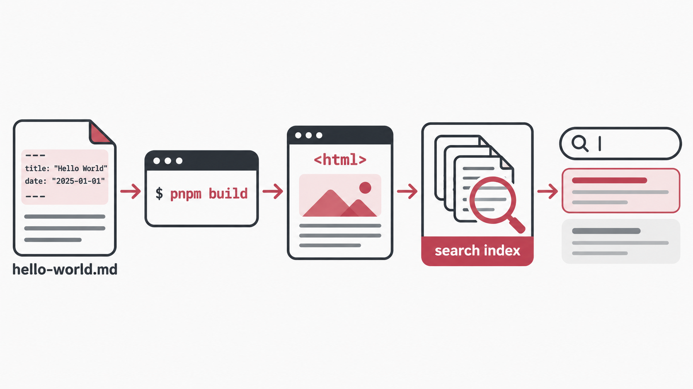

> 「写作不是把想清楚的东西表达出来，而是写作本身让事情变清楚。」

你好，我是 Scudlen，一名入门的低级“零栈”开发工程师，喜欢折腾各种新技术。欢迎来到「哥斯拉笔记」！

这篇是开篇之作，顺便也是一篇**排版元素演示**：以后写文章会用到的所有花样，都在这篇里展示一遍。导航栏里还有一个 English 入口，点过去，目录、日期和导航菜单会换成英文，你仍然可以接着读这篇中文文章；两种界面也共用同一个评论串，等评论启用后，如果发现哪一步讲得含糊，欢迎直接在文章下面指出来。

## 为什么要写博客

简单说三个理由：

1. **写作本身让事情变清楚。** 很多想法在脑子里是模糊的，写下来的过程中才会被迫想清楚：这个概念我到底懂了没有？这个命令我真的会敲吗？写完再回头看，常常会删掉一些自己都讲不通的段落，剩下的才是真正立得住的。

2. **给值得再走一遍的小实验留个档。** 假如半年后的我想知道「一个静态博客怎么搜到刚发的文章」，希望能在这里翻出当时用的命令，顺着它再走一遍。博客对我来说更像一本工作笔记，而不是作品集。

3. **把过程摊开，接受指正。** 我把源码放在 GitHub 上，这个仓库里既能看到写这篇文章的 Markdown，也能看到负责发布的工作流。写错了的地方，欢迎直接告诉我。

## Markdown 元素速览

下面是本站博文会用到的全部排版元素，以后写新文章可以回来直接抄格式。右侧的目录也是由这些 `##` 和 `###` 标题自动生成的。

### 文本样式

正文里可以用 **加粗** 强调重点，用 *斜体* 表示轻微的语气，用 ~~删除线~~ 保留修改痕迹，用 `行内代码` 标注文件名、命令或变量，还可以放[链接](https://github.com/Scudlen7/godzilla-blog)。

比如这篇文章在仓库里叫 `hello-world.md`，文件名决定了文章地址里的 `hello-world`，所以以后就算我想改标题，你收藏的链接也还能用。

### 列表

无序列表适合罗列并列的东西：

- 值得记下来的想法
- 值得再走一遍的小实验
- 写了一半、还没结论的草稿

有序列表适合写步骤：

1. 把文章写成一份带 frontmatter 的 Markdown 文件
2. 在项目根目录运行 `pnpm build`，Astro 构建站点，Pagefind 生成搜索索引
3. 把新稿推到 `main`，GitHub Actions 会自动重新构建并发布站点

### 引用

> 引用块适合放一句想强调的话，或者摘录别人的观点。
>
> 比如开篇那句：「写作不是把想清楚的东西表达出来，而是写作本身让事情变清楚。」

### 表格

| 命令 | 作用 |
| --- | --- |
| `pnpm dev` | 本地启动开发服务器，边写边预览 |
| `pnpm build` | 构建 HTML，并让 Pagefind 编入搜索索引 |
| `pnpm preview` | 本地预览构建后的完整站点 |

### 代码块

带语言标注的代码块会自动加上语法高亮：

```sh
pnpm build
```

这一条命令里，我最喜欢的是最后一步。Astro 先把文章和 AstroSage 主题一起构建成 HTML，随后 Pagefind 才去读这些已经生成的页面，把正文编进搜索索引。等你读完这篇，可以在本站的搜索框里输入「小实验」，看看能不能沿着这三个字把这篇找回来。

### 图片



图片会自动居中显示。建议把图片放在文章同级的 `assets` 目录里、用相对路径引用，以后迁移站点也不会断链。

---

第一篇就写到这里。那么,正式开张。🚀
