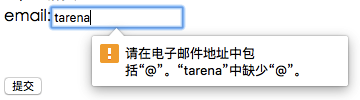
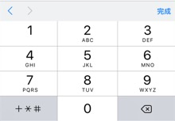
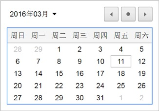
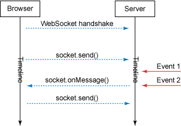

> 「先让一句话站上网页，再让网页会动、会记事儿。」

我在翻之前学 HTML 记的笔记的时候，我当时就把它们分成两沓。一沓是基础：标签、段落、链接、图片、列表、表格、表单，全是给内容搭骨架的东西。另一沓是 HTML5：音视频、Canvas、SVG、拖放、本地存储、WebSocket，是给网页装新本领的东西。

这门课我是怎么学的？一半靠学校课程，老师把顺序和重点排好了，跟着走就行；一半靠查文档，MDN 被我当成字典，忘了哪个标签怎么拼就去翻；剩下最管用的，是边做边学——想往页面里加什么，就去查什么，坑也是这么一个个踩出来的。(而且现在AI这么发达，我相信学习这个对大家来说也不是什么难事)

这篇就把两类笔记合在一起，从第一个 hello world 写到 WebSocket。每一站配一段能直接跑的最小示例，写清楚三件事：它是什么、什么时候用、我踩过什么坑。适合刚入门的同学对照着看，也适合学完一阵、想回头复习的人。篇幅不短，慢慢看，看不完收藏起来以后当手册翻也行。

## 第一站：HTML 到底是个什么东西

HTML 的全称是 Hyper Text Markup Language，中文叫「超文本标记语言」。名字里有两个词值得拆开看。

**超文本**，说的是页面里不只有文字。图片、链接、音乐、视频，甚至一段程序，都可以放进来，「超」就超在这里。

**标记语言**，说的是它的活儿：不是教电脑算什么，而是给内容贴标签，告诉浏览器「这一段是什么」。`<h1>` 是标题，`<p>` 是段落，`` 是一张图。就像整理箱子时往盒子上贴便签——内容还是那些内容，贴了标签，别人（浏览器、搜索引擎、读屏软件）才知道该怎么对待它。

所以 HTML 不是编程语言。它没有变量、没有循环、没有判断，常用标签一个星期就能认全。这是好事，也是坏事：语法不难，难的是「什么时候该用哪个标签」。

顺手记一下来历。1980 年，蒂姆·伯纳斯-李为了让世界各地的物理学家方便合作研究，做出了最早的 HTML——纯文字格式，任何文本编辑器都能写。1993 年，还在上大学的马克·安德森在 Mosaic 浏览器里加了 `` 标签，从此网页上能看到图片。后来人们想往网页里塞的东西越来越多，HTML 就一路扩充：1995 年的 2.0、1997 年的 3.2 和 4.0、1999 年的 4.01，再往后就是 HTML5——2008 年公布第一份正式草案，2014 年成为 W3C 的正式推荐标准。

## 第二站：第一个网页，其实没几行

笔记里最早的例子，主体只有一行：`<font color="red">hello world!</font>`。`font` 这个标签现在已经不推荐用了（想改颜色是 CSS 的事），但整份文档的骨架和今天没有区别：

```html
<!DOCTYPE html>
<html lang="zh-CN">
<head>
  <meta charset="UTF-8">
  <title>01_helloworld.html</title>
</head>
<body>
  <!-- 这是第一个页面 helloworld -->
  <h1>hello world!</h1>
</body>
</html>
```

### 标签、元素、属性

HTML 标签是被尖括号包起来的关键词，通常成对出现：`<b>` 是开始标签，`</b>` 是结束标签。被一对标签包住的内容加上标签本身，整体叫一个「元素」。也有不成对的「空元素」，比如换行 `<br>`，里面没有内容，自己就完事了。

属性写在开始标签里，用「名称="值"」的形式给元素补充信息，比如 `lang="zh-CN"` 表示这份文档用简体中文。有两个习惯值得从第一天就养成：属性值永远用引号包起来（双引号单引号都行），标签和属性都写小写。HTML 对大小写不敏感，`<P>` 和 `<p>` 效果一样，但 W3C 一直推荐小写，越往后越是强制。

这份骨架里每一层管什么，值得先记牢：

- `<!DOCTYPE html>` 放在最前面，它不是标签，是告诉浏览器「这份文档是 HTML5」。以前 HTML 4.01 的声明是一长串，HTML5 简化成这一句。
- `html` 是整份文档的根，所有东西都包在里面。
- `head` 放给浏览器看的信息，比如标签页标题、编码声明，读者在页面上看不到它。
- `body` 放给人看的内容，正文都在这里。
- `title` 决定浏览器标签页上写什么。
- `meta charset="UTF-8"` 告诉浏览器用 UTF-8 来读这份文档。少了它，中文可能变成一串乱码。

### head 里还有什么

`title` 之外，`head` 里还能放：`style`（写在页面里的样式）、`link`（引入外部样式表）、`script`（脚本）、`base`（这一页所有相对链接的默认地址），以及最常见的 `meta`。`meta` 是给浏览器和搜索引擎看的元数据，比如：

```html
<meta name="keywords" content="HTML, CSS, JavaScript">
<meta name="description" content="我的 HTML 学习笔记">
<meta name="author" content="Scudlen">
<meta http-equiv="refresh" content="30">
```

前三行分别告诉搜索引擎关键词、页面描述和作者；最后一行是每 30 秒刷新当前页，属于少数直接指挥浏览器的用法。

### 注释

注释的写法是 `<!-- 这是一条注释 -->`。开始括号后面要紧跟一个感叹号，结尾不需要。浏览器会忽略注释，但人会看——写清楚「这段在干什么」，对以后回头改代码的自己最友好。

> Tips:HTML 对错误极其宽容：忘写 `</p>`、标签没闭合，大多数浏览器照样能把页面显示出来。对新手这是福利，也是陷阱——「浏览器不报错」不等于「写对了」。等页面里接进 JavaScript 和构建工具，这些没闭合的小地方就可能变成莫名其妙的错误。所以从第一张页面起，就按规范写。闭合标签是省不掉的开销。

## 第三站：把文字排成一篇文章

最常用的排版标签就四件：标题 `h1` 到 `h6`、段落 `p`、换行 `br`、水平线 `hr`。笔记里用《春晓》当例子：

```html
<h1>春晓</h1>
<hr>
<p>
  春眠不觉晓，<br>
  处处闻啼鸟。<br>
  夜来风雨声，<br>
  花落知多少。
</p>
```

- 标题从 `h1` 到 `h6`，`h1` 最大，`h6` 最小。浏览器会自动在标题和段落前后加一点空隙，不用自己操心。
- `br` 是同一段话里的换行。注意：在编辑器里敲回车，网页上并不会换行——浏览器会把源码里连续的空格和换行合并成一个空格。想要固定断行，就得写 `<br>`。
- `hr` 画一条水平分隔线，用来隔开两段内容。

> 关于标题，笔记里有一句话我划了重点：标题在浏览器里显示成多大，并不重要，重要的是语义。搜索引擎看一个页面时，`h1` 的分量仅次于 `title`，所以一个页面一般只放一个 `h1`；其余各级标题按内容的层级来选，别为了「看起来小一点」就把 `h2` 的内容硬写成 `h5`。长得不好看，以后交给 CSS 调，这才是分工。

## 第四站：链接和图片，让网页「连」起来

网页之所以叫「网」，靠的就是链接。`a` 标签加 `href` 属性，就把文字变成能点的入口：

```html
<a href="https://developer.mozilla.org/zh-CN/" target="_blank">去 MDN 查文档</a>
<a href="#poem">跳到本页的原诗</a>
<a href="mailto:someone@example.com">给我们写邮件</a>
```

`href` 写网址，就是跳到别的页面；写 `#poem` 这样「#加名字」的形式，就是跳到本页里带有 `id="poem"` 的那个元素，这就是锚点跳转；写 `mailto:` 开头，点了会打开邮件客户端。`target="_blank"` 表示在新标签页里打开，不加就在当前窗口跳。

图片用 `img`，两个必需属性：`src` 是图片地址，`alt` 是替代文本。

```html


<a href="big-flower.html">
  
</a>
```

有两个细节值得注意。第一，图片其实不是「插入」页面的，`img` 只是占了个位子、记了个地址，浏览器读到这儿才去下载那张图。第二，`img` 嵌进 `a` 里，图片就变成了可以点击的链接，这是很常见的用法。

再把路径说清楚。`src="flowers.jpg"` 是相对路径，意思是「和这个 HTML 文件放同一个文件夹里的 flowers.jpg」。如果图片收进了子文件夹，就写 `src="images/flowers.jpg"`。什么时候会踩坑？当你把图片挪了位置却忘了改路径——代码看着一点没错，网页上的图就是不显示，只剩一个打不开的图标。

> 这条是我心里的「新手第一坑」。另外 `alt` 也别糊弄，它是给图片兜底的：图片加载失败时、网速慢还没下完时、读屏软件给视障用户读页面时，靠的都是 `alt`。写「雨后的石阶上散落着几片花瓣」，就比写「图片1」有用得多。至于 `img` 的 `align` 这类老属性，HTML5 已经不支持了——对齐、边框这些事，现在都归 CSS 管。

## 第五站：三种列表，各有各的语义

列表在网页里到处都是：导航菜单、文章目录、操作步骤，底层都是列表。HTML 给了三种：

- `ul` 无序列表，配 `li` 当每一项，前面显示圆点。导航菜单、并列的几条信息，用它。
- `ol` 有序列表，配 `li`，浏览器自动编号。步骤、排行榜这种有先后关系的，用它。
- `dl` 定义列表，`dt` 是「词」，`dd` 是「解释」，适合术语表、常见问题。

```html
<ul>
  <li>咖啡</li>
  <li>茶
    <ul>
      <li>红茶</li>
      <li>绿茶</li>
    </ul>
  </li>
  <li>牛奶</li>
</ul>
```

上面这个例子里，`li` 里面再套一个 `ul`，就是嵌套列表，缩进一层、圆点换一种样式。定义列表长这样：

```html
<dl>
  <dt>HTML</dt>
  <dd>超文本标记语言，负责网页的结构。</dd>
  <dt>CSS</dt>
  <dd>层叠样式表，负责网页的样子。</dd>
</dl>
```

`ol` 的 `type` 属性（改成 A、a、I、i 编号）和 `start`（起始数字）在老教程里常见，但 HTML5 不推荐了，编号样式交给 CSS 的 `list-style-type`。

> Tips:既然 `div` 什么都能装，为什么还要分三种列表？因为列表把「这里有几项、谁属于谁」明明白白写进了结构里。读屏软件会念「列表，共 3 项」，搜索引擎也看得懂这是一组相关内容。这种「用对标签」的意识，就是后面反复出现的「语义化」的起点。

## 第六站：表格，先想清楚行列再动手

表格由 `table` 包住，`tr` 是一行，`td` 是一格；第一行常换成 `th`，表示表头。一张最普通的人员信息表：

```html
<table>
  <caption>人员信息</caption>
  <tr>
    <th>姓名</th><th>性别</th><th>年龄</th>
  </tr>
  <tr>
    <td>张三</td><td>男</td><td>18</td>
  </tr>
  <tr>
    <td>李四</td><td>女</td><td>16</td>
  </tr>
</table>
```

`th` 里的字默认加粗居中，`td` 里的字默认靠左，浏览器靠这个区分表头和数据。`caption` 是表格的标题，必须紧跟在 `<table>` 后面写，一张表只能有一个。

再往上还有三个把人分组用的标签：`thead` 包表头、`tbody` 包主体、`tfoot` 包页脚。平时看不出效果，好处在长表格：打印时表头和页脚可以出现在每一页的顶部和底部。

想让单元格跨行跨列，用 `colspan`（跨几列）和 `rowspan`（跨几行）——「电话」这一列想横跨两格，就把表头写成 `<th colspan="2">电话</th>`，然后对应位置少写一格。写之前先在纸上画一遍格子，比对着代码数格子快得多。

> Tips:表格的标签看着吓人，其实只有两个问题——这一格是哪行哪列的？这一格占几格？至于 `border="1"` 这种给表格加边框的老写法，现在也不推荐了，边框归 CSS 管。

## 第七站：表单，网页第一次「收东西」

前面所有标签都是「网页给人看」，表单开始变天了：网页第一次能从人这里收东西。`form` 圈出填写区，`action` 说提交给谁，`method` 说用什么方式提交。

```html
<form action="#" method="post">
  用户名:<input type="text" name="username" placeholder="你的名字"><br>
  密码:<input type="password" name="pwd"><br>
  性别:
  <input type="radio" name="sex" value="male" checked>男
  <input type="radio" name="sex" value="female">女<br>
  爱好:
  <input type="checkbox" name="like" value="java">Java
  <input type="checkbox" name="like" value="php">PHP<br>
  城市:
  <select name="city">
    <option value="bj">北京</option>
    <option value="nj" selected>南京</option>
  </select><br>
  <input type="submit" value="提交">
</form>
```

这一小段里藏着表单的几种基本角色：`text` 文本框、`password` 密码框（输入变圆点）、`radio` 单选（同名的互为一组，只能选一个）、`checkbox` 复选（能选多个）、`select` 加 `option` 下拉列表、`submit` 提交按钮。想要多行输入，用 `textarea`，它能按回车。还有 `label` 标签，配上 `for="控件的id"`，点文字就能聚焦到对应输入框，多行输入时特别好用。

提交方式 `method` 常见两种：`get` 会把数据拼在地址栏里，看得见，适合搜索这类查询；`post` 把数据放在请求里，不显示在地址栏，提交表单常用它。

### HTML 实体

表单笔记的最后还有一个常被忽略的小节：实体。尖括号是标签的语法符号，想把它当普通文字显示出来，就得用转义字符：

- `&nbsp;` 空格
- `&lt;` 小于号 `<`
- `&gt;` 大于号 `>`
- `&amp;` 和号 `&`
- `&copy;` 版权符号 ©

规律很好记：lt 是 less than，gt 是 greater than，amp 是 ampersand。在页面里要显示 `<p>` 两个字而不让它变成真标签，就写 `&lt;p&gt;`。

> Tips:看表单代码时，有两个名字总在眼前晃——`id` 和 `name`。分工其实很清楚：`id` 是页面内的门牌号，`label` 的 `for`、锚点链接的 `#` 都靠它找人；`name` 是提交时的字段名，浏览器把「名字=用户填的值」打包发给服务器。这俩搞混，就会出现「点标签没反应」或者「服务器收不到数据」这类查半天的问题。

——到这里，基础篇的地基就打完了：文字、链接、图片、列表、表格、表单。回头看会发现，这批标签有个共同点：它们都是「内容本身」。下半程的 HTML5 画风就不一样了，它开始让网页「做事」。

## 第八站：HTML5，网页从「文档」变成「应用」

笔记里对 HTML5 的定位写得很准：它不是 HTML 4.01 的推翻重来，而是把它往前推了一大步，让网页从「一种文档」变成一个成熟的应用平台——视频、音频、图像、动画、跟电脑的交互，全都标准化进了浏览器本身。

HTML5 是 W3C 和 WHATWG 两家合作出来的成果。笔记里盘点的核心新特性有这么一批：

- 语义化元素：`header`、`footer`、`section` 这类「看名字就知道是干嘛的」结构标签
- 表单 2.0：`input` 新增一批类型和属性
- 本地存储：不靠第三方插件，也能在浏览器里存数据
- WebSocket：浏览器和服务器之间的双向实时通信
- 服务器推送事件（SSE）：服务器主动往浏览器推消息
- Canvas：用 JavaScript 编程的方式画图
- 音视频：`video`、`audio` 直接嵌进网页，告别插件
- 地理定位：用户同意后，网页能拿到位置
- 拖放：把网页上的东西抓起来放到另一个位置

浏览器支持方面，笔记当年专门提醒「IE8 及以前基本不支持」。那会儿兼容性是真问题；现在这些特性在所有现代浏览器里都铺开了，当年的顾虑基本可以放下，学它们的性价比反而更高了。查资料的入口也记一个：[MDN](https://developer.mozilla.org/zh-CN/)，HTML5 的字典。

> Tips:HTML5 最深的变化不是「多了几个标签」，而是网页的定位变了。以前浏览器的主业是「展示文档」，HTML5 之后它开始「运行应用」——你在网页里看视频、画图、拖文件、收到实时消息，背后都是这一套。理解了这一层，后面的特性就都能串起来：它们全都在给网页加「应用能力」。

## 第九站：表单 2.0，输入框开始「认得」你填的东西

### 一批新输入框

基础篇的 `input` 基本只有 `text`、`password` 几样，HTML5 一口气加了一批「知道自己要收什么」的类型：

| 类型 | 效果 |
| --- | --- |
| `email` | 邮箱输入框，提交时检查有没有 `@` |
| `url` | 网址输入框，检查像不像网址（笔记里说查有没有 `http://`） |
| `search` | 搜索框，手机键盘的回车键会变成「搜索」 |
| `tel` | 电话输入框，手机上直接弹数字键盘 |
| `number` | 数字输入框，可以配 `min`、`max`、`step` |
| `range` | 滑动条，拖来拖去选数值 |
| `color` | 调色板，点开就是颜色选择器 |
| `date` / `month` / `week` | 日期 / 月份 / 周的输入框，自带日历面板 |

```html
<form>
  邮箱:<input type="email" placeholder="you@example.com"><br>
  年龄:<input type="number" min="18" max="60" step="1"><br>
  音量:<input type="range" min="0" max="100" value="50"><br>
  生日:<input type="date"><br>
  喜欢的颜色:<input type="color"><br>
  <input type="submit" value="提交">
</form>
```







> Tips:这些类型的价值不在好看，在于让浏览器免费送你三样东西：手机端弹对键盘、提交前帮你查格式、该选的时候给个选择器。但别指望太多——`email` 只检查有没有 `@`，不检查这个邮箱真实存在；`tel` 根本不强制数字；PC 端的 `search` 和 `text` 长得一模一样，好处全在手机上。浏览器给的是「顺手」，不是「保险」。

### 新元素：datalist、progress、meter、output

| 元素 | 用途 |
| --- | --- |
| `datalist` | 给输入框配一份「候选清单」，输入时自动提示。用 `input` 的 `list` 属性绑定 |
| `progress` | 进度条，表示任务完成了多少，配 JavaScript 一起用 |
| `meter` | 度量衡，表示一个已知范围内的数值，比如磁盘用了多少 |
| `output` | 显示计算结果，比如两个输入框相加的和 |

`progress` 和 `meter` 很容易搞混，一句话分清：`progress` 是「进行中的任务」，`meter` 是「一个刻度值」。下载进度用前者，硬盘占用率用后者。

### 新属性：placeholder、autofocus、multiple、form

`placeholder` 在输入框里放灰色提示文字，输入就消失；`autofocus` 让某个框在页面打开时自动获得焦点；`multiple` 允许一次选多个（`email` 和 `file` 能用）；`form` 更妙——输入框可以写在 `form` 外面，靠 `form="表单id"` 声明自己仍属于那张表单。

### 校验：能交给浏览器的，就别自己写

HTML5 给了一批开箱即用的校验属性：`required` 不能为空、`pattern` 配正则、`min`/`max` 限范围、`maxlength` 限长度。

```html
<form>
  用户名:<input type="text" name="user" required><br>
  邮编:<input type="text" name="code" pattern="[0-9]{6}" title="六位数字"><br>
  <input type="submit" value="提交">
</form>
```

浏览器在提交时自动拦下不合格的输入；如果想知道具体是哪儿不对，可以去读输入框的 `validity` 对象，它上面挂着一串布尔值：`valueMissing`（必填没填）、`typeMismatch`（格式不符，比如 email 没有 @）、`patternMismatch`（没通过正则）、`rangeUnderflow` / `rangeOverflow`（小于 min / 大于 max）……再配上 `setCustomValidity("自定义提示")`，就能让提示话术变成自己的。

> Tips:前端校验的目的是帮用户少走弯路，不是安全防线。绕过它太容易了——禁用 JavaScript、绕过页面直接发请求都行。所以哪怕页面上校验再齐全，服务器端也要再校验一遍。这句话在笔记里我标了星号。

## 第十站：音视频，Flash 时代的终结

在 `video` 和 `audio` 之前，网页里放视频主要靠 Flash。笔记里列了 Flash 的三条「罪状」：不是浏览器原生支持（得装插件）、性能不好、移动端不支持。HTML5 把音视频做成了浏览器原生能力，一条都解决了。

视频格式最主要的是 MP4，另外还有 OGV 和 WebM（Google 出品，支持超高清）。音频主要是 MP3、OGG、WAV。不同浏览器支持的格式不完全一样，所以可以塞多个 `source`，让浏览器从上往下挑一个认识的：

```html
<video controls width="480" poster="cover.jpg">
  <source src="oceans-clip.mp4">
  <source src="oceans-clip.webm">
  <source src="oceans-clip.ogv">
  你的浏览器不支持 video 标签
</video>
```

常用属性五个：`controls` 显示播放控制条、`autoplay` 自动播放、`loop` 循环、`poster` 指定还没开播时的封面图、`preload` 控制预加载（`none` 不加载、`auto` 尽快加载、`metadata` 只加载元信息）。`audio` 的用法和 `video` 几乎一个模子。

想让播放受代码控制，就轮到方法和事件了：`play()` 播放、`pause()` 暂停、`load()` 重新加载；事件有 `play`、`pause`、`ended`、`error`；属性里 `paused` 表示是否暂停、`currentTime` 能读取或设置播放到哪儿了、`duration` 是总时长。笔记里那个「播放/暂停」按钮的例子，就是监听按钮点击、看 `paused` 决定调 `play()` 还是 `pause()`。

> Tips:一个 `video` 标签背后其实是浏览器自带的播放器——这是它和 Flash 最大的区别，也是为什么「多准备几种格式」成了习惯。另外提一句现在的情况：很多浏览器会拦截带声音的自动播放，除非用户先有操作或者视频是静音的，这是各家保护用户的策略，写 `autoplay` 时心里要有数。

## 第十一站：Canvas，用代码画画

Canvas 是 HTML5 给的「画布」：不用引入图片，直接用 JavaScript 在上面画。它主要用在两个方向：网页里的图表，以及 2D 网页游戏。

```html
<canvas id="cv" width="320" height="160" style="border:1px solid #ccc"></canvas>
<script>
  var ctx = document.getElementById("cv").getContext("2d");

  ctx.fillStyle = "orange";        // 先定样式
  ctx.fillRect(20, 20, 120, 80);   // 再画实心矩形

  ctx.beginPath();                 // 再来一个描边的圆
  ctx.arc(240, 60, 40, 0, Math.PI * 2);
  ctx.stroke();
</script>
```

入门要记的几件事：

- `canvas` 天生有尺寸，默认 300×150，和 `div` 不一样。改尺寸要用 `width`、`height` 属性；用 CSS 改会把图形拉伸变形。
- 画图前先用 `getContext("2d")` 拿到画笔（上下文对象），之后所有绘制都通过它。
- 三个矩形函数：`fillRect` 画实心、`strokeRect` 画空心、`clearRect` 擦掉一块。
- 样式和绘制的顺序很重要：先 `fillStyle` / `strokeStyle` / `globalAlpha` 定好样式，再画；改一次样式，只对它之后画的图形生效。
- 画复杂图形用路径：`beginPath()` 起笔，`moveTo` 落笔、`lineTo` 连线、`arc` 画圆弧，最后 `fill()` 或 `stroke()` 收尾。角度用的是弧度，一整圈是 `Math.PI * 2`。
- 往画布上放图片用 `drawImage(img, x, y)`，但必须等图片的 `onload` 触发之后才画——图还没加载完就调用，什么都不会发生。
- 画布状态可以用 `save()` / `restore()` 存取，移动、缩放、旋转用 `translate` / `scale` / `rotate`，做动画时会用到。

自己一笔一笔画太累的话，笔记里还介绍了一个图表库 Chart.js：引入一个 JS 文件，准备好数据数组，几行代码就能出曲线图、柱状图、饼状图、雷达图、环形图和极地区域图。

> Tips:Canvas 最容易被误会的一点——画上去的图形不是元素。画完之后整块画布就是一张位图，那个圆不是「一个能点的圆」，它没法绑事件、没法用 DOM API 操作。所以 Canvas 适合「整体绘制」的场景：图表、2D 游戏。反过来，如果希望每个图形都能单独操作，那是对面 SVG 的地盘。另外记一笔：笔记里的 Chart.js 还是 1.x 时代的写法（`new Chart(ctx).Pie(data)`），后来 Chart.js 更新到 4.x，API 完全换了一副样子——第三方库的用法一定要对着当时的官方文档写，笔记上最好标个日期，这段就当个教训。

## 第十二站：SVG，放大不糊的矢量图

SVG 全称 Scalable Vector Graphics，可缩放矢量图形。它是一种用 XML 描述二维图形的语言。和 Canvas 那种「像素画布」不同，SVG 里画的是一条条数学意义上的线——所以放大多少倍都不糊。矢量图就是这个词的字面意思。

严格说 SVG 不是 HTML5 的专属技术，它比 HTML5 年长得多。但在 HTML5 之前只能把它当图片引进来（``），HTML5 之后允许直接把 SVG 写进 HTML 页面。

```html
<svg width="220" height="120" style="background:#f7f7f7">
  <rect x="10" y="10" width="90" height="90"
        fill="#a2d2ff" stroke="#333" stroke-width="2"/>
  <circle cx="165" cy="55" r="45" fill="#ffc8dd"/>
</svg>
```

基本图形有六种：矩形 `rect`、圆形 `circle`、椭圆 `ellipse`、直线 `line`、折线 `polyline`、多边形 `polygon`。样式三件套通用：`fill` 填充、`stroke` 描边、`stroke-width` 描边宽度。渐变要放在 `defs` 里定义（线性渐变 `linearGradient`、射线渐变 `radialGradient`，用 `stop` 定颜色），再用 `fill="url(#渐变id)"` 引用；滤镜容器 `filter` 里的 `feGaussianBlur` 可以做高斯模糊。笔记里还提了个上手友好的库 Two.js，`makeCircle`、`makeRectangle` 一行一个图形，最后 `two.update()` 统一绘制。

SVG 和 Canvas 的区别，笔记整理过一张表，我用自己的话转述一遍：

| | SVG | Canvas |
| --- | --- | --- |
| 分辨率 | 与分辨率无关，放大不糊 | 依赖分辨率，放大会糊 |
| 图形本质 | 每个图形都是 DOM 节点，能绑事件、能改属性 | 画完是一整张位图，不能用 DOM 和事件 |
| 擅长 | 图标、图表、地图这类大型渲染区域 | 2D 游戏、逐帧重绘 |

> Tips:选 Canvas 还是 SVG，本质是问自己一句：我要的是一张图，还是一堆图形对象？图形不多、要缩放、要交互（比如地图上的每一个标记），用 SVG；图形成千上万、每一帧都在变（比如游戏），用 Canvas。想明白这一句，这类选择题就都会做了。

## 第十三站：拖放，把东西抓起来放下去

拖放说的是：按住一个元素，拖到另一个地方，松手放下。被拖的叫「源元素」，放到的叫「目标元素」，两边各有一套事件。

源元素这边：`dragstart`（开始拖，只触发一次）、`drag`（拖动过程中，反复触发）、`dragend`（结束拖，只触发一次）。目标元素这边：`dragenter`（拖到了，进一次）、`dragover`（在目标上方，反复触发）、`drop`（放下了）、`dragleave`（拖走了）。

```html
<div id="box1"></div>
<div id="box2" style="min-height:140px; border:1px dashed #999"></div>

<script>
  var pic = document.getElementById("pic");
  var box2 = document.getElementById("box2");

  pic.addEventListener("dragstart", function (e) {
    e.dataTransfer.setData("text", pic.src);   // 把图片来源存进"剪贴板"
  });
  box2.addEventListener("dragover", function (e) {
    e.preventDefault();                        // 不写这句，drop 永远不会触发
  });
  box2.addEventListener("drop", function (e) {
    var src = e.dataTransfer.getData("text");  // 从"剪贴板"里取出来
    box2.innerHTML = '';
    pic.remove();
  });
</script>
```

中间那个 `dataTransfer` 对象可以理解成拖放专用的剪贴板：`dragstart` 时用 `setData(type, data)` 把要搬运的数据存进去，`drop` 时用 `getData(type)` 取出来，还有 `clearData()` 清空。

> Tips:这个功能我卡最久的事只有一件——`dragover` 忘了 `preventDefault()`，`drop` 死活不触发，查了半天。原理是：浏览器默认不允许把东西「放」到页面上，`dragover` 里调 `preventDefault()` 就是在举手说「这块地方可以放」，说了才轮到 `drop` 上场。记住这一点，拖放就通了七成。

## 第十四站：Web Storage，网页终于能自己记事

浏览器早就能存数据了，用的是 cookie，但 cookie 有硬伤：只有 4KB 左右，而且每次请求都会捎给服务器，拿它当仓库不合适。HTML5 给了 Web Storage，用键值对在客户端存数据，容量大，只存在本地。

两兄弟区别只在「活多久」：

| | `sessionStorage` | `localStorage` |
| --- | --- | --- |
| 数据寿命 | 关掉页面或浏览器就没了 | 一直留着，除非主动删 |
| 适合存 | 一次会话里的临时数据 | 想长期记住的偏好、设置 |

两者的方法一模一样，五件套：

```javascript
localStorage.setItem("nickname", "哥斯拉");   // 存
console.log(localStorage.getItem("nickname")); // 取：哥斯拉
localStorage.key(0);                          // 按序号取键名
localStorage.removeItem("nickname");          // 删一个
localStorage.clear();                         // 全清
```

除了当方法调，也能直接当属性用：`localStorage.nickname = "哥斯拉"`，效果一样。另外 `localStorage` 身上有个 `storage` 事件，当**别的标签页**改了数据时会触发，事件里带着 `key`、`oldValue`、`newValue` 和 `url`——多标签页同步数据就靠它。

> Tips:两点。第一，它只能存字符串，要存对象得先 `JSON.stringify` 再存、取出来 `JSON.parse`，直接存对象会被转成 `[object Object]`。第二，别把它当保险箱：Web Storage 并不比 cookie 更安全，密码、卡号这类敏感信息，客户端哪里都别放。

## 第十五站：WebSocket，服务器能主动找你了

要理解 WebSocket 的好，得先知道没有它的时候怎么做实时通信。笔记里的答案是**轮询**：客户端每隔几秒向服务器发一次请求，问「有新消息吗」，靠高频询问来保持同步。原理简单，但费流量、有延迟——像每隔五分钟去门口看一眼快递到没到。另一个老办法是 Flash 的 Socket，Flash 退场后自然也就没了。

WebSocket 换了思路：浏览器和服务器先用一次 HTTP 握手接上头，之后这条连接就保持住，变成双向通道，两边谁想说话随时说——快递员到了直接给你打电话。请求地址不是 `http://`，而是 `ws://`（加密的叫 `wss://`）。



```javascript
var ws = new WebSocket("ws://127.0.0.1:2346");

ws.onopen = function () {
  ws.send("tom");                 // 连上了，先发一句
};
ws.onmessage = function (e) {
  console.log("收到：" + e.data); // 服务器说什么都在这儿接
};
ws.onclose = function () {
  console.log("连接关闭");
};
```

API 就这几样：构造函数 `new WebSocket(url)` 负责建立连接；`send(data)` 发数据；`close()` 关连接；四个事件 `onopen` / `onmessage` / `onerror` / `onclose` 覆盖连接的完整一生。还有一个属性 `readyState` 可以查连接状态：0 正在连接、1 已连通、2 正在关闭、3 已关闭。

> Tips:WebSocket 只有前端这一半，另一半在服务器。笔记里的例子是拿 Workerman（一个 PHP 的框架）起了个服务，客户端才连得上 `127.0.0.1:2346`。所以试这个特性时别光盯着浏览器——服务端起不来，`onopen` 永远等不到。这也是它和前面那些标签最不一样的地方：从它开始，你的页面得和一个「活的服务」打交道了。

## 第十六站：Web Workers，把重活儿丢到后台

JavaScript 是单线程的：一段耗时计算跑起来，页面就卡住，点什么都没反应。Web Workers 的思路很直接——开一个后台线程干活，主线程该响应响应。就像给页面配了个后台同事：活儿打包发给他，他算完了再把结果送回来，中间你该干嘛干嘛。

```javascript
// 主线程
var worker = new Worker("task.js");     // 把后台同事请来（同源策略要满足）
worker.postMessage(100000);             // 派活儿：算 1 加到 10 万
worker.onmessage = function (e) {
  console.log("算完了：" + e.data);     // 收结果
};
```

```javascript
// task.js —— 后台同事的工位
onmessage = function (e) {
  var sum = 0;
  for (var i = 0; i <= e.data; i++) sum += i;
  postMessage(sum);                     // 干完把结果送回去
};
```

Worker 分两种：Dedicated（专用线程）跟着创建它的页面走，页面关了它就没了，绝大多数场景用的都是它；Shared（共享线程）可以被多个页面共用，所有相关页面都关了才终止。

有几个限制得记牢：Worker 里**不能碰 DOM**，也碰不到 `window`、`document` 和全局变量，`alert()`、`confirm()` 这类弹窗也不让用。能用的东西里值得一提的是 `navigator`（可以读 userAgent 等浏览器信息）。通信全靠 `postMessage` / `onmessage` 一对搭档，两边都能发也能收，所以双向通信就是两边都监听 `onmessage`。想立刻终止，调 `terminate()`；出错了用 `onerror` 接，错误信息里有 `message`、`filename`、`lineno` 三样。

> Tips:Workers 最适合两类活儿：不打扰界面的重计算，和替页面在后台跟服务器做异步交互。但记住它的位置——他在后台，看不见页面，别指望他在 Worker 里改 DOM，也不可能。分工想清楚，用起来就很顺。

## 第十七站：百度地图，拿别人的 API 拼自己的页面

笔记的最后一篇是实战：把百度地图嵌进自己的页面。这类「第三方 API」的套路，一篇上手，以后换谁家都差不多。三步走：

```html
<!-- 第一步：引入百度地图的 JS（ak 是申请来的密钥） -->
<script src="https://api.map.baidu.com/api?v=2.0&ak=你的密钥"></script>

<body>
  <!-- 第二步：准备一个容器 -->
  <div id="allmap" style="width:100%; height:400px"></div>

  <script>
    // 第三步：创建地图、初始化
    var map = new BMap.Map("allmap");
    map.centerAndZoom("北京", 12);   // 中心点 + 缩放级别（一般 3~19）
    map.enableScrollWheelZoom();     // 允许滚轮缩放
  </script>
</body>
```

地图的能力都挂在 `BMap` 这个对象上：`Map` 是地图本体；`ScaleControl`（比例尺）、`NavigationControl`（平移缩放）、`MapTypeControl`（地图类型切换）、`OverviewMapControl`（缩略图）这些控件用 `addControl` 挂上去；`Marker` 是标注，`InfoWindow` 是点开的信息窗口，用 `addOverlay` 加到地图上；`Geocoder` 能把一个地址解析成经纬度，反过来查坐标位置就靠它。笔记最后那个例子，就是把「北京市海淀区万寿路西街2号」解析成坐标、打上标注、点标注弹出信息窗口，一气呵成。

> Tips:把这一站看成 HTML5 之旅的收尾特别合适——能力是别人家的（地图数据、渲染引擎都在百度的服务器上），你只出三样东西：一个容器、几行配置、一把证明身份的密钥（ak）。笔记里那串 ak 是教程的，自己要用得去官网申请；密钥也别直接贴进公开的仓库里。另外，百度地图的 JS API 这些年已经更新了好几代，笔记里 v2.0 的写法在当时没问题，现在真做项目，以官方文档为准——这又是一条对「笔记要标日期」的印证。

## 写在最后：学完这一圈，剩下的几条感受想法

把这十八篇笔记从头到尾重新过了一遍，除了知识点本身，还有几条我的感受想留下来。

**第一，HTML 的语法一周能看完，真正花时间的是「选择」。** 这段内容该是 `h2` 还是 `p`？这里该用表格还是列表？语义化三个字说起来简单，做起来就是把「这段内容是什么」一遍遍想清楚。选择比记忆难，也比记忆值钱。

**第二，浏览器太宽容，别被「能显示」骗了。** 闭合标签写全、结构写对、大小写统一——这些规范平时看不出好处，等页面接进 JavaScript、接进各种工具，好处就全回来了。

**第三，HTML5 的一大半新本领，HTML 只出了个舞台，演员全是 JavaScript。** 视频的播放暂停、Canvas 的每一笔、拖放的搬运、WebSocket 的收发、Worker 的通信，随便点开一个例子，里面都站着 JS。所以学完 HTML5 这些新能力，学 JavaScript 的动力根本不用别人劝，自己就冒出来了。

**第四，说说学习方法。** 学校课程给的是地图，告诉你往哪走；MDN 这样的文档是字典，随时查「这个词什么意思」；真正把知识钉进脑子的是项目——哪怕只是一个小页面，边做边查边踩坑，比看十遍教程都记得牢。三者缺一不可。

**最后一条，算是复读这个博客的开篇：写作让事情变清楚。** 这些笔记躺在文件夹里的时候，我一直以为自己都会了；真按顺序写下来，才发现好几处只能写出个「大概」。写不清楚的地方，就是还没学会的地方，回去补一遍，才算真的过了一遍。这可能比复习本身更重要。

---

你正在读的这个页面，从导航、正文、代码块到右边的目录，本身就是一堆 HTML 标签堆出来的。学 HTML 最有意思的地方大概就在这儿：你学的每一课，都立刻长在你眼前的这个网页上。下一个想折腾的方向，是让这堆标签真正动起来——那又是另一个故事了。
