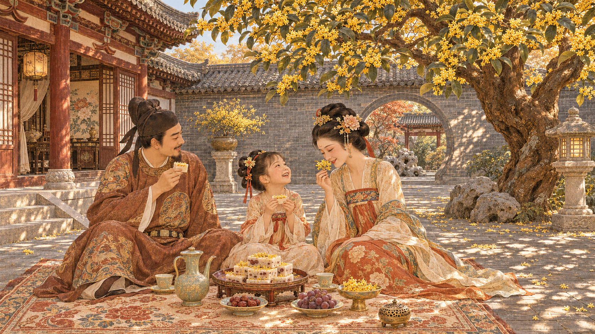

以前我在网上看到好看的图，第一反应就是存下来。存着存着，硬盘都快爆炸了，我才突然想起来，我自己学的就是跟 AI 相关的东西，怎么还只会存图？有想看的画面，为什么不自己写个 Prompt 试试？

后来我整理了一份文生图提示词的笔记，光是能写进 Prompt 的要素就数出了 16 个。今天就拿我之前用《长安的荔枝》里一段文字跑出来的图，讲讲这条 Prompt 是怎么写出来的。

## 1 先把你想画的东西说清楚

比如我想画一张春天的图，脑子里已经有个大概的样子了。如果我只说“画一张好看的春日庭院”，AI 画棵桃树也行，画满院子的迎春花也行。“好看”这个词留给它的发挥空间太大了。

但我如果想看的是白裙、桃花，还有傍晚那种暖暖的光，就可以直接这么写。

```text
一张中国风水彩画。一位穿白裙的年轻女子站在盛开的桃花树下，背景是中式庭院。画面以浅粉和白色为主，黄昏的暖光照在花瓣和裙摆上。用三分法构图，人物站在画面左侧，略微仰视，16:9 横图。
```

我觉得，刚开始写的时候，先说清楚**谁在什么地方做什么**，就已经能解决不少问题了。接着再想自己最在意的是画风、光线，还是画面里某个一定要有的东西。

## 2 这 16 个要素，卡住的时候翻一下

当时记笔记，我恨不得把所有东西都往公式里塞，颇有种做一桌满汉全席的架势。后来再看，我觉得分成几组比较好找。

- **画什么**。主体、环境、场景、文化元素、叙事。比如一家三口是主体，中式庭院是环境，秋日下午是场景。铺开毯子、分糕赏花，几个人之间就有了点故事。
- **画成什么样**。画风、材质、色彩、灯光、细节层次。比如同样是一面墙，可以写青灰色的大砖、清楚的砖缝，再写树影落在墙上。每个词都能落到画面里的某个地方。
- **怎么看这幅画**。构图、视角、比例与分辨率。想让人看清糕点，就写特写。想让人看清一家人和院子的关系，就把视野拉开。如果图要拿来做封面，还可以写清标题那一侧留多少空。
- **还有什么特别想表现的**。动态、情绪与感官、特殊技法。比如风吹得花瓣往哪边落，雨后地面有没有反光，或者想要一点老照片的胶片颗粒。

对我而言，这张清单最有用的时候，是我看着一张图觉得“好像差点什么”，又说不上来差在哪儿。比如嫌画面太平，就回头看看光从哪里来，有没有写清楚。能说出具体想改的地方，下一版 Prompt 就知道该补什么了。

## 3 从《长安的荔枝》拆出一张图

《长安的荔枝》第一章里，李善德去看一间小宅子。鱼鳞瓦、柏木檩条、大青砖，院子里还有一棵高大的桂花树。去看宅子的时候才二月，他已经想到八月休沐那天，跟夫人和女儿在院子里铺条毯子，一边吃刚蒸的重阳米锦糕，一边赏桂花。

这段里我想画的是他脑子里的那个下午。所以时间就选八月，画里就让桂花开得正盛。小说里的人物、动作和院子都有了，剩下的就是怎么把它们放进同一张画里。

我先把原文和笔记里的要素清单丢给 Claude，让它拆一遍。如果你手上也有一段小说或者一小段场景描述，可以这么问。

```text
请把下面这段文字拆成文生图提示词。我要画的是【选定的场景】。
先提取人物、动作、时间、地点和原文明确写到的细节，再分别给出画风、配色、光线和构图建议。把原文写明的细节和你建议补充的细节分开写。
最后整理成一段可以直接复制去生图的 Prompt。

原文放在这里【粘贴原文】
```

Claude 拆出来的东西挺多，从粗麻布毯子、酒坛的釉面，到三分法、略微俯视，都给了建议。我最后拿去给 ChatGPT 跑的那一版，重点放在一家三口在做什么、院子长什么样，还有下午的光。下面就是当时用的原始 Prompt。

```text
中国古典工笔画风格，唐朝八月秋日庭院，一家三口围坐毯子上品尝重阳糕赏桂花，鱼鳞瓦古建筑，都邬大青砖院落，高大桂花树盛开，温和下午阳光透过树叶斑驳光影，暖色调金黄棕褐青灰配色，写实主义精致细节，宁静惬意家庭氛围，16:9高清画质
```



我挺喜欢图里小女孩仰着头看她妈妈的样子。一家三口围坐、桂花开满枝头、阳光透过树叶落到砖地上，这些是我在 Prompt 里点过的。小女孩看向谁，毯子上多了茶壶和果盘，就是 AI 自己补出来的细节。

这条 Prompt 里也没写镜头和构图。如果我只是想看看小说里那个场景长什么样，人物和院子都能看清就够了。要是想把图拿去做封面，我就会再写一句，让一家人坐到右边，左边留一块干净的地方放标题。

## 4 总结一下

所以说吧，我现在写 Prompt，会先想这张图里哪几个东西最舍不得丢。像这张图，桂花、重阳糕，还有一家人在院子里悠闲地坐一会儿，这几个写清楚，我想画的那个下午就有了。至于果盘里放葡萄还是别的，我倒是挺乐意看看 AI 会怎么摆。

以前遇到喜欢的图，我就先存下来。现在读到喜欢的一段，也能试着把脑子里闪过的画面做出来。
